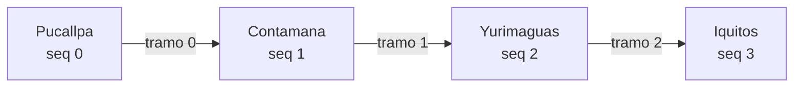

# Inventario, capacidad por tramos y concurrencia

**Objetivo:** que sea **imposible** vender dos veces el mismo asiento, cama, camarote o espacio de vehículo en tramos que se solapan, y que ninguna zona de capacidad general (zona libre, hamacas, bodega, cubierta) supere su límite en ningún tramo, aunque varias réplicas de la API, varias taquillas y el portal online vendan al mismo tiempo.

**Garantía:** la dan **restricciones de PostgreSQL**. El código de la aplicación verifica antes para dar mensajes claros, pero si fallara, la base de datos rechaza igual la operación.

---

## 1. Tramos



Un viaje de la parada `a` a la `b` ocupa el **rango semiabierto `[a, b)`**, es decir, los tramos `a … b-1`.

| Venta | Rango | Tramos ocupados |
|---|---|---|
| Pucallpa → Contamana | `[0,1)` | 0 |
| Pucallpa → Yurimaguas | `[0,2)` | 0, 1 |
| Contamana → Iquitos | `[1,3)` | 1, 2 |
| Yurimaguas → Iquitos | `[2,3)` | 2 |

Dos rangos **se solapan** si comparten al menos un tramo: `[0,1)` y `[1,3)` **no** se solapan (se tocan en Contamana); `[0,2)` y `[1,3)` **sí** (comparten el tramo 1).

## 2. Dos mecanismos según el tipo de inventario

| Inventario | Ejemplos | Mecanismo | Garantía en PostgreSQL |
|---|---|---|---|
| **Recurso asignable** (identificado individualmente) | Asiento 12A, cama C3-B1, camarote C5 sin camas definidas, espacio de vehículo V2 | `resource_allocations` con `int4range` | **Restricción de exclusión GIST** |
| **Capacidad agregada** (cantidad sin identidad) | Zona libre (personas), hamacas, bodega (kg, m³), cubierta de carga (kg, m lineales), **aforo total de la nave** | `trip_pool_segment_usage` por tramo | **Bloqueo de fila ordenado + `CHECK (used <= capacity)`** |

Una misma venta puede usar ambos. Por ejemplo, un pasajero con asiento en una embarcación consume el **asiento** (recurso) y una unidad del **aforo total de personas** de la nave (pool).

## 3. Recursos asignables: restricción de exclusión

```sql
CREATE EXTENSION IF NOT EXISTS btree_gist;

CREATE TABLE resource_allocations (
  id               uuid PRIMARY KEY,
  tenant_id        uuid NOT NULL,
  trip_id          uuid NOT NULL,
  trip_resource_id uuid NOT NULL,
  stop_range       int4range NOT NULL CHECK (NOT isempty(stop_range)),
  status           allocation_status NOT NULL,      -- HELD | CONFIRMED | RELEASED
  hold_expires_at  timestamptz,
  holder_type      allocation_holder NOT NULL,      -- BOOKING_ITEM | CARGO_ASSIGNMENT | BLOCK
  holder_id        uuid NOT NULL,
  FOREIGN KEY (tenant_id, trip_resource_id) REFERENCES trip_resources (tenant_id, id),
  CONSTRAINT resource_no_overlap EXCLUDE USING gist (
    trip_resource_id WITH =,
    stop_range       WITH &&
  ) WHERE (status <> 'RELEASED')
);
```

**Cómo actúa con concurrencia** (nivel de aislamiento `READ COMMITTED`, el predeterminado):

- Si la transacción T1 insertó una asignación que choca y aún no ha hecho `COMMIT`, el `INSERT` de T2 **espera**.
- Si T1 confirma, T2 recibe `23P01 exclusion_violation` y la API responde `409 RESOURCE_UNAVAILABLE`.
- Si T1 se revierte, T2 continúa y obtiene el recurso.

No hay ninguna ventana en la que ambas puedan confirmarse.

### Ejemplo A: mismo asiento, tramos parcialmente superpuestos, simultáneo

Asiento **12A**. La taquilla de Pucallpa vende Pucallpa→Yurimaguas `[0,2)` y, en el mismo instante, el portal online vende Contamana→Iquitos `[1,3)`.

| t | Taquilla (T1) | Portal (T2) |
|---|---|---|
| 1 | `BEGIN` | `BEGIN` |
| 2 | `INSERT (12A, [0,2), HELD)` ✅ (bloqueo implícito en el índice) | |
| 3 | | `INSERT (12A, [1,3), HELD)` ⏳ espera a T1 (comparten el tramo 1) |
| 4 | `COMMIT` | |
| 5 | | ❌ `23P01` → `ROLLBACK`; el cliente ve "Asiento no disponible para Contamana–Iquitos" |

### Ejemplo B: mismo asiento, tramos contiguos (no se solapan)

Pucallpa→Contamana `[0,1)` y Contamana→Iquitos `[1,3)` sobre el asiento **12A**: ambos `INSERT` se confirman. El asiento se reutiliza legítimamente en Contamana.

### Ejemplo C: retención expirada

Una retención `HELD` con `hold_expires_at` vencido **sigue bloqueando** hasta pasar a `RELEASED`, porque la condición de la restricción es `status <> 'RELEASED'`, no la fecha. Así una retención nunca desaparece por el reloj sin dejar registro. Para no depender del job de expiración, la transacción de venta primero ejecuta:

```sql
UPDATE resource_allocations SET status = 'RELEASED'
 WHERE trip_resource_id = ANY($resources) AND status = 'HELD' AND hold_expires_at < now();
```

y luego inserta. Si dos ventas compiten por un recurso recién liberado, vuelve a aplicar el Ejemplo A.

### Ejemplo D: camarote completo frente a camas individuales (corrección del diseño anterior)

> **Corrección.** La versión anterior proponía una asignación "parcial" del camarote al vender una cama. Esto habría impedido vender **dos camas distintas del mismo camarote** a la vez, porque ambas asignaciones parciales chocarían en el camarote. Se reemplaza por esta regla.

- Si el camarote tiene camas definidas (elementos hijos), **el inventario son las camas**. El camarote no es asignable por sí mismo.
- **Vender el camarote completo** = insertar en **una sola transacción** una asignación por **cada cama** con el mismo rango y el mismo titular. El precio se toma de la tarifa del camarote (`price_class_code` del padre).
- **Vender una cama** = insertar solo esa cama.

| t | Venta camarote C3 completo `[0,3)` (T1) | Venta cama C3-B2 `[2,3)` (T2) |
|---|---|---|
| 1 | `INSERT C3-B1 [0,3)` ✅ | |
| 2 | `INSERT C3-B2 [0,3)` ✅ | `INSERT C3-B2 [2,3)` ⏳ espera |
| 3 | `INSERT C3-B3, C3-B4` ✅ → `COMMIT` | |
| 4 | | ❌ `23P01` (C3-B2 ocupada en el tramo 2) |

Dos camas distintas (C3-B1 y C3-B2) vendidas a la vez **no** chocan. Si una cama ya está vendida, el `INSERT` correspondiente de la venta completa falla y la transacción entera se revierte. No se venden camarotes "incompletos".

Una **cama compartida** (capacidad 2) es un único recurso: se vende entera a una reserva con hasta 2 pasajeros. Si una empresa necesita vender plazas sueltas en camas compartidas, esa zona se modela como pool de personas (sección 4).

## 4. Capacidades agregadas: contadores por tramo con bloqueo ordenado

```sql
CREATE TABLE trip_pool_segment_usage (
  tenant_id   uuid NOT NULL,
  pool_id     uuid NOT NULL,          -- (viaje, zona, dimensión)
  segment_seq int  NOT NULL,
  capacity    numeric(14,3) NOT NULL,
  used        numeric(14,3) NOT NULL DEFAULT 0,
  PRIMARY KEY (pool_id, segment_seq),
  CONSTRAINT pool_within_capacity CHECK (used >= 0 AND used <= capacity)
);
```

Las filas se **materializan al abrir el viaje a la venta**: una por pool y tramo. Nunca se crean de forma perezosa.

**Algoritmo de asignación** de `q` unidades en `[a, b)` sobre uno o varios pools:

```sql
-- 1) Bloquear TODAS las filas necesarias en orden global determinista
SELECT pool_id, segment_seq, capacity, used
  FROM trip_pool_segment_usage
 WHERE pool_id = ANY($pools) AND segment_seq >= $a AND segment_seq < $b
 ORDER BY pool_id, segment_seq
   FOR UPDATE;
-- 2) La aplicación verifica: nº de filas = nº pools × (b − a), y used + q ≤ capacity en cada una
--    → si falla, error de negocio con el pool y el tramo exactos
-- 3) Incrementar
UPDATE trip_pool_segment_usage SET used = used + $q
 WHERE pool_id = $pool AND segment_seq >= $a AND segment_seq < $b;
-- 4) Registrar la asignación para poder liberarla exactamente
INSERT INTO pool_allocations (pool_id, stop_range, quantity, status, holder_type, holder_id) VALUES (...);
```

- **`FOR UPDATE` en `READ COMMITTED`**: si otra transacción tiene la fila bloqueada, se espera. Al obtener el bloqueo, PostgreSQL **relee la versión confirmada más reciente**, así que el paso 2 nunca trabaja con un valor obsoleto.
- **El orden `pool_id, segment_seq`** es el mismo en toda la aplicación, lo que evita *deadlocks* entre ventas que tocan varios pools o tramos.
- **El `CHECK` es la red final**: aunque un error de código omitiera el paso 2, el `UPDATE` que supere la capacidad falla (`23514`) y la transacción se revierte.
- La liberación (cancelación, expiración o reembolso) hace `used = used − quantity` sobre el mismo rango y marca `RELEASED` en la misma transacción.

### Ejemplo E: zona libre con tramos parcialmente superpuestos

Zona libre con capacidad 10 por tramo. Ocupación actual: tramo 0 = 9, tramo 1 = 9, tramo 2 = 4.

| t | T1: 1 persona Pucallpa→Yurimaguas `[0,2)` | T2: 1 persona Contamana→Iquitos `[1,3)` |
|---|---|---|
| 1 | Bloquea tramos 0 y 1 (lee 9, 9) | |
| 2 | | Intenta bloquear el tramo 1 ⏳ (T1 lo tiene) |
| 3 | 9+1 ≤ 10 ✅ → `used` = 10, 10 → `COMMIT` | |
| 4 | | Obtiene el bloqueo y **relee** el tramo 1 = 10. Bloquea el tramo 2 (4) |
| 5 | | 10+1 > 10 ❌ → "Zona libre completa entre Contamana y Yurimaguas" |

Sin control por tramos, T2 habría sido rechazada o aceptada con información falsa. Aquí se rechaza **solo** porque el tramo 1 está lleno. Una venta Yurimaguas→Iquitos `[2,3)` seguiría disponible (4/10).

### Ejemplo F: encomiendas en bodega, varias dimensiones a la vez

Bodega de la lancha: 2 000 kg y 12 m³ por tramo. Un traslado de encomiendas de 300 kg y 2,1 m³ en `[0,3)` bloquea **6 filas** (2 pools × 3 tramos) en orden y verifica ambas dimensiones. Si el volumen alcanza pero el peso no, se rechaza todo. Un traslado concurrente que solo va `[2,3)` compite únicamente por las filas del tramo 2.

### Ejemplo G: vehículo en cubierta de carga (recurso + pools + compatibilidad)

Camión de 18 t, 9,5 m de largo, en la cubierta de una motonave con espacios de vehículo `V1–V6`, un límite de 60 t y 40 m lineales por tramo.

1. **Compatibilidad física**: el largo, ancho y alto del camión ≤ los máximos de la zona; el peso ≤ el máximo por unidad; la rampa es compatible. El resultado se guarda como snapshot. Si la zona exige aprobación manual (maquinaria pesada), la asignación queda `PLANNED` hasta la aprobación de un rol autorizado.
2. En **una** transacción: `INSERT resource_allocations (V3, [0,3))` (exclusión) **y** bloqueo y suma en los pools `WEIGHT_KG` (+18 000) y `LINEAR_M` (+9,5) para los tramos 0–2.
3. Un segundo camión simultáneo que pida `V3` falla por exclusión. Si pide `V4` pero el peso acumulado del tramo superaría 60 t, falla por el pool.

### Ejemplo H: aforo total de la embarcación

Toda venta de pasajero (asiento, cama, camarote o zona libre) suma 1 al pool `PERSONS` de **toda la nave**. Así se respeta el aforo autorizado por la autoridad marítima aunque la suma de zonas configuradas lo exceda. El recurso y el pool se asignan en la misma transacción; si cualquiera falla, no se vende nada.

## 5. Garantías transversales

| Riesgo | Protección |
|---|---|
| Doble clic o reintento de red en la misma venta | `Idempotency-Key` obligatoria en `POST /bookings`, `/shipments`, `/payments` → `idempotency_keys` (UNIQUE): el reintento devuelve la misma respuesta |
| Pago duplicado de la pasarela | UNIQUE (`provider`, `provider_ref`) |
| Doble emisión de boleto | Índice único parcial: un boleto vigente por `booking_item_id` |
| Encomienda en dos traslados abiertos | Índice único parcial por `package_id` en traslados no cerrados |
| Viaje cerrado o cancelado | Comprobación del estado del viaje con `SELECT … FOR SHARE` sobre `trips` en la transacción de venta; el cierre toma `FOR UPDATE` |
| Caché de disponibilidad obsoleta (Redis) | Solo afecta a lo que se **muestra**; la confirmación siempre pasa por PostgreSQL |
| Cambio de unidad con ventas | Flujo explícito con mapeo y conflictos. Nunca se reasigna en silencio (`trip_vehicle_changes`) |

**¿Por qué no `SERIALIZABLE`?** Funcionaría, pero convierte los conflictos en reintentos genéricos (`40001`) difíciles de explicar al usuario y degrada con mucha concurrencia en viajes populares. Las restricciones explícitas dan errores precisos ("asiento ocupado en el tramo 1") y bloquean solo las filas en conflicto.

## 6. Pruebas obligatorias (prueba de concepto en la Fase 2; suite completa en las Fases 7 y 8)

Contra un PostgreSQL real, nunca con *mocks*:

1. 50 transacciones concurrentes por 12A `[0,2)`: exactamente 1 éxito.
2. `[0,1)` y `[1,3)` sobre 12A concurrentes: 2 éxitos.
3. `[0,2)` y `[1,3)` sobre 12A concurrentes: 1 éxito.
4. Camarote completo frente a 4 ventas de camas individuales concurrentes: o bien el camarote o bien las camas, nunca una mezcla inválida. Dos camas distintas a la vez: ambas se confirman.
5. Pool con capacidad 10 y 25 ventas concurrentes de 1 con rangos aleatorios: ningún tramo supera 10, y el `used` de cada tramo es igual a la suma de las asignaciones activas que lo cubren.
6. Venta multi-pool (peso + volumen) concurrente en orden inverso: sin *deadlocks*.
7. Expiración de una retención y reventa inmediata.
8. Invariante global tras cada prueba: `trip_pool_segment_usage.used` = Σ `pool_allocations` activas (consulta de reconciliación, que también se ejecutará como job de monitoreo en producción).
