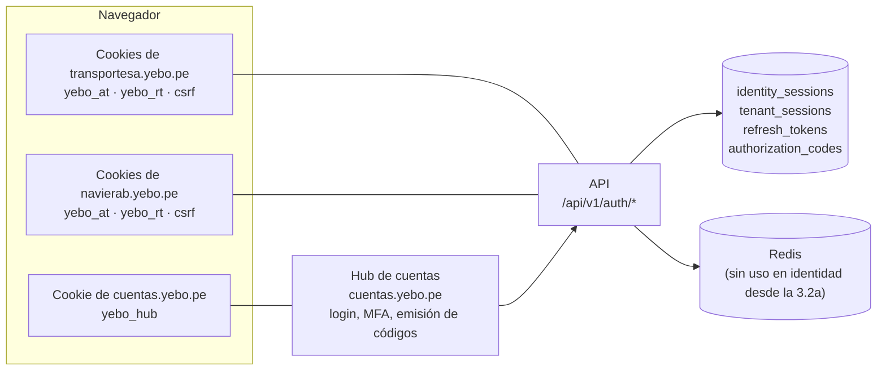
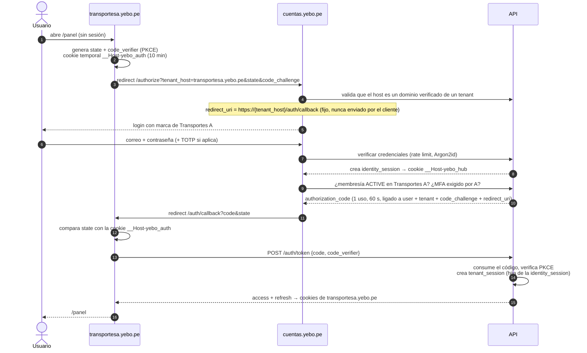
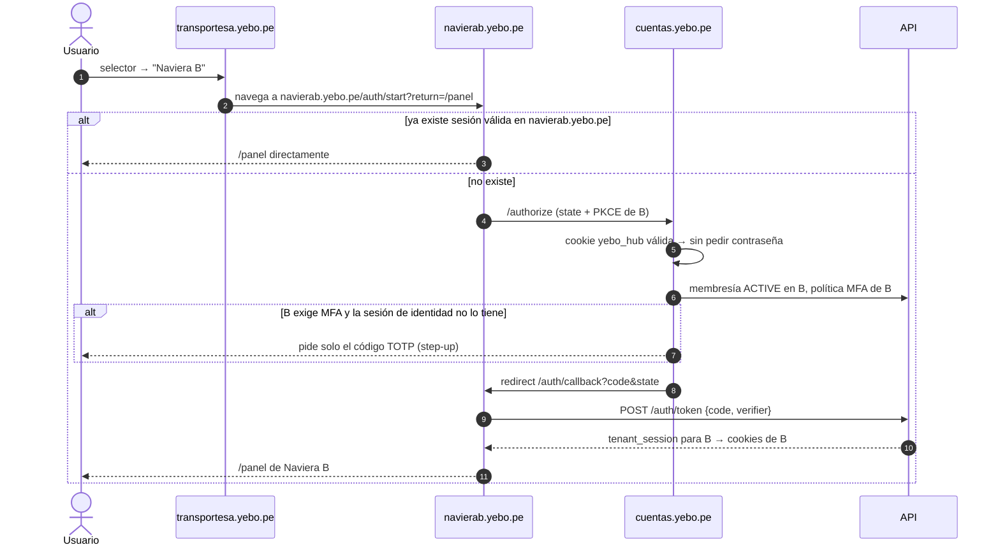

# Identidad, sesiones y cambio de empresa

Decisión base: **D3**. Una identidad global por persona y membresías por empresa (ADR-005). Este documento detalla la autenticación, el cambio de empresa, las sesiones, los refresh tokens y la revocación (ADR-009, ADR-022).

## 1. Objetivo de experiencia

| Situación | Lo que vive el usuario |
|---|---|
| Primer ingreso del día | Una pantalla de login con la marca de su empresa. Correo + contraseña (+ MFA si aplica) |
| Cambiar de empresa | **Un clic** en el selector. Sin volver a escribir la contraseña. ~1 s de redirecciones invisibles |
| Volver a una empresa ya abierta | Instantáneo (la sesión de ese dominio sigue viva) |
| Trabajar con dos empresas en dos pestañas | Permitido: cada dominio tiene su propia sesión |
| Cerrar sesión | Cierra todas las empresas abiertas **en ese navegador**. Los demás dispositivos no se ven afectados |

## 2. Piezas

| Pieza | Dónde vive | Para qué |
|---|---|---|
| **Hub de cuentas** | `cuentas.<dominio-plataforma>`, servido por `apps/web` y presentado con la marca del tenant de origen | El **único** lugar donde se escriben credenciales y MFA. Mantiene la sesión de identidad que permite cambiar de empresa sin contraseña |
| **Sesión de identidad** (`identity_sessions`) | Cookie `__Host-yebo_hub` solo en el hub | Prueba de que la persona se autenticó en este navegador. No da acceso a ningún dato de empresa |
| **Sesión de empresa** (`tenant_sessions`) | Cookies del dominio de esa empresa | Acceso a **una** empresa con **una** membresía. Hija de una sesión de identidad |
| **Access token** | Cookie `__Host-yebo_at`, JWT de 10 min | Autoriza cada request a la API de esa empresa |
| **Refresh token** | Cookie `__Secure-yebo_rt`, `Path=/api/v1/auth`, opaco | Renueva el access token. Se rota en cada uso |
| **Código de autorización** (`authorization_codes`) | Viaja una sola vez en la URL de regreso | Transfiere la autenticación del hub al dominio de la empresa |

Por qué un hub: las cookies no pueden compartirse entre `transportesa.yebo.pe`, `navierab.yebo.pe` y, en el futuro, dominios propios como `www.transportesa.pe`. El hub es el patrón estándar (OAuth 2.0 / OIDC *authorization code* + PKCE) para tener una sola autenticación y muchas sesiones por dominio sin compartir cookies. Se evaluará usar `oidc-provider` (librería certificada OIDC) en la Fase 3 en lugar de una implementación propia.

## 3. Flujo 1: primer ingreso

Si el usuario **no** tiene membresía activa en la empresa del dominio, el hub muestra "No tienes acceso a Transportes A" y la lista de **sus propias** empresas. No revela nada de otros usuarios ni de la empresa.

## 4. Flujo 2: cambio de empresa (un clic)

- La sesión de A **no se cierra**. El usuario puede volver a A con el mismo selector sin redirecciones.
- El selector se alimenta de `GET /me/memberships`, que solo devuelve las membresías del propio usuario (nombre, logo y dominio de cada empresa).
- El "último tenant usado" se recuerda en el hub para el login desde `cuentas.yebo.pe` directo.

## 5. Protecciones del flujo

| Amenaza | Protección |
|---|---|
| Robo del código en la URL | PKCE: sin el `code_verifier`, que nunca sale del dominio de destino, el código no sirve. Además es de un solo uso, dura 60 s y la cabecera `Referrer-Policy: no-referrer` está activa en el callback |
| *Login CSRF* (un atacante hace que la víctima entre con la cuenta del atacante) | `state` ligado a la cookie temporal del dominio que inició el flujo |
| Redirección abierta | `redirect_uri` derivado del `tenant_host`, que debe ser un dominio verificado en `tenant_domains`. No se acepta una URL del cliente |
| Uso del código en otra empresa | El código está ligado al `tenant_id` y al `redirect_uri`, y `POST /auth/token` valida que el host que lo canjea coincide |
| Fuerza bruta en el login | Rate limit por IP + cuenta, bloqueo progresivo y respuesta idéntica para cuenta inexistente o contraseña errónea |
| Cookies leídas por JavaScript | `httpOnly`, `Secure` y prefijo `__Host-` (ligada al host exacto, sin `Domain`) |
| CSRF en mutaciones de la API | `SameSite=Lax` + token *double-submit* (cookie `csrf` + cabecera `X-CSRF-Token`). La API está en el mismo origen (`{tenant}/api`, vía Nginx), así que no se abre CORS para la web |

> **Implementación de la Fase 3.2b (2026-11-10):**
> - El inicio va por `GET /api/v1/auth/start` en el dominio de la empresa. El `state` y el `code_verifier` viven en la cookie firmada `__Host-yebo_auth`; el verifier no pasa por el JavaScript del navegador.
> - El callback es una página que canjea el código **por POST** (`/api/v1/auth/token`).
> - La cookie del hub contiene el id de la sesión de identidad firmado.
> - Reutilizar un código revoca la sesión emitida con él.
> - Detalle y pruebas en [phase-3-plan](../development/phase-3-plan.md).

## 6. Refresh tokens

- Opacos (256 bits), **hasheados** (SHA-256) en `refresh_tokens`, con `family_id` = sesión de empresa.
- **Rotación**: cada uso devuelve un refresh nuevo y marca el anterior como `used_at`.
- **Detección de reutilización**: presentar un refresh ya usado fuera de la ventana de gracia revoca la **sesión de empresa completa** (la familia) y queda auditado como posible robo.
- **Ventana de gracia de 20 s**: varias pestañas pueden refrescar a la vez. Si llega el refresh recién rotado dentro de esa ventana, se devuelve **el mismo** sucesor (respuesta idempotente) en lugar de tratarlo como robo. El frontend además coordina el refresh entre pestañas con la Web Locks API.
- Expiración: inactividad configurable por tenant (p. ej., 12 h para turnos de taquilla) y máximo absoluto (p. ej., 30 días).

> **Precisión de la Fase 3.2a (2026-11-09):**
> - Para devolver el mismo sucesor, el token rotado guarda el sucesor **cifrado** (AES-256-GCM, con una clave HKDF derivada del propio token en claro). Solo lo descifra quien presenta ese token; nunca se guarda en claro y no se usa Redis.
> - La familia y el sucesor se modelan con `parent_id` (UNIQUE por sesión), sin `successor_id`.
> - Detalle en [phase-3-plan](../development/phase-3-plan.md).

## 7. Validación en cada request

1. Firma y expiración del JWT (`sub`, `sid`, `tid`, `mid`, `ver`).
2. `tid` == tenant resuelto por el host.
3. **Estado de la sesión en PostgreSQL**, en una sola consulta por clave primaria:
   - sesión de empresa y sesión de identidad no revocadas ni expiradas;
   - membresía y usuario ACTIVE;
   - `permissions_version` vigente;
   - y, si el request tiene tenant en su contexto, que coincida.

   *(Precisión de la Fase 3.2a, 2026-11-09: el diseño aprobado decía "en Redis, con PostgreSQL de respaldo". La auditoría demostró que una caché positiva aceptaba sesiones revocadas durante hasta 60 s. Por decisión del responsable, PostgreSQL es la fuente de verdad en cada petición. Ver [phase-3-plan](../development/phase-3-plan.md).)*
4. `ver` == `permissions_version` actual de la membresía. Si difiere, responde `401 PERMISSIONS_CHANGED`. El frontend refresca en silencio y obtiene un token con los permisos nuevos. **No** cierra la sesión.

Gracias al paso 3, la revocación surte efecto en **toda verificación que empiece después de su COMMIT**, no "en cuanto expire el access token". Una petición que ya pasó su verificación termina con el estado que tenía (carrera documentada en phase-3-plan).

## 8. Revocación

| Evento | Qué se revoca | Efecto |
|---|---|---|
| "Cerrar sesión" | La sesión de identidad del navegador + todas sus sesiones de empresa hijas | Fuera de todas las empresas en ese navegador. Otros dispositivos siguen |
| "Cerrar sesión en todos los dispositivos" | Todas las sesiones de identidad y de empresa del usuario | Fuera en todas partes |
| Cambio o restablecimiento de contraseña | Todas, salvo opcionalmente la actual | — |
| La empresa A suspende o revoca la membresía | Todas las sesiones de empresa de esa membresía | Fuera de A de inmediato. **B no se ve afectada** |
| La empresa A cambia los roles | Nada. `permissions_version++` | El siguiente request se re-emite con los nuevos permisos |
| El administrador de A pulsa "cerrar sesiones del usuario" | Solo las sesiones de esa membresía en A | No puede afectar al usuario en otras empresas |
| Reutilización de un refresh token | La sesión de empresa (familia) | Re-login en esa empresa |
| Usuario deshabilitado globalmente (por el titular o por YEBO) | Todo | — |
| Tenant suspendido | **Nada** | Las sesiones siguen. `TenantStatusGuard` limita las operaciones según la matriz de [multitenancy.md](multitenancy.md#5-estados-del-tenant-y-operaciones-permitidas) |

El usuario puede ver sus sesiones (dispositivo, empresa, última actividad) y cerrarlas una a una desde su perfil en el hub.

## 9. PWA operativa y dispositivos

Los dispositivos de embarque y almacén se **registran** (`devices`, con aprobación de un administrador de la empresa) y usan `Authorization: Bearer` con refresh tokens ligados al dispositivo y de mayor duración, para tolerar la navegación sin conexión. Revocar el dispositivo invalida sus tokens. Los detalles corresponden a la Fase 14.

## 10. Alternativa considerada (descartada para el MVP)

**Login directamente en el dominio de la empresa, sin que se vea el hub.** Es más "white label", porque el usuario nunca ve `cuentas.yebo.pe`. Pero para conservar el cambio de empresa sin contraseña haría falta, después del login, un salto oculto al hub para crear la sesión de identidad. Esto añade complejidad y superficie de ataque. **Decisión (2026-11-05):** hub centralizado en **`cuentas.yebo.pe`** con la identidad visual de la empresa desde la que se inicia el acceso. La seguridad, la revocación y el aislamiento de sesiones tienen prioridad sobre la personalización visual.

## 11. Cambios en el modelo de datos

- `sessions` se reemplaza por **`identity_sessions`** (hub) y **`tenant_sessions`** (por empresa, con `identity_session_id`).
- `auth_handoff_codes` se reemplaza por **`authorization_codes`**: `code_hash`, `user_id`, `tenant_id`, `identity_session_id`, `redirect_uri`, `code_challenge`, `expires_at`, `consumed_at`.
- `refresh_tokens.session_id` pasa a `tenant_session_id`. Se añaden `successor_id` y `rotated_at` para la ventana de gracia.
- **Fase 3.2a (2026-11-09):**
  - `refresh_tokens` no tiene `successor_id`: el sucesor se obtiene por `parent_id`, con `UNIQUE (tenant_session_id, parent_id)`;
  - se añade `successor_ciphertext` (sucesor cifrado para la ventana de gracia);
  - las tres tablas de sesión son exclusivas del rol `yebo_identity`.
