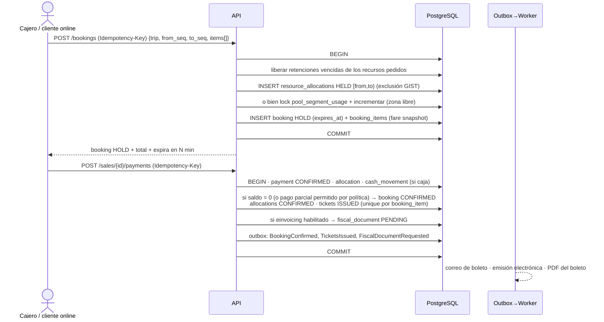
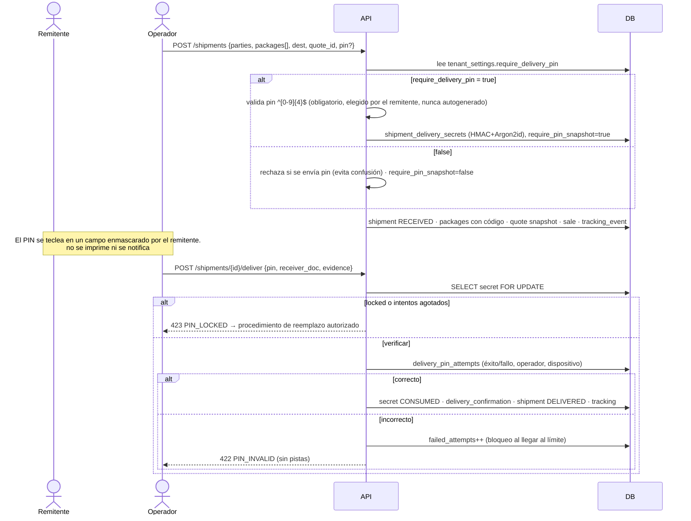
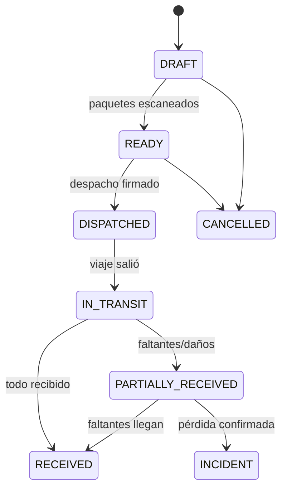
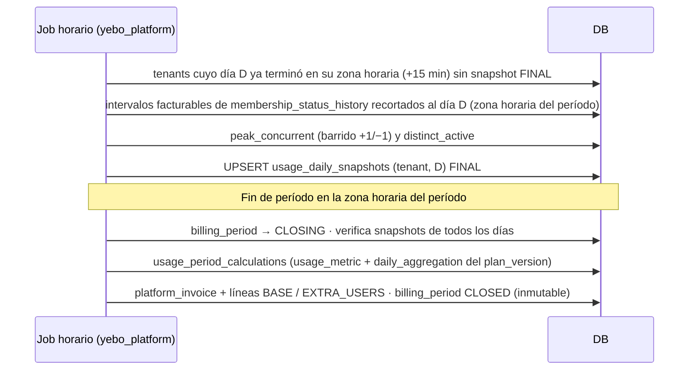
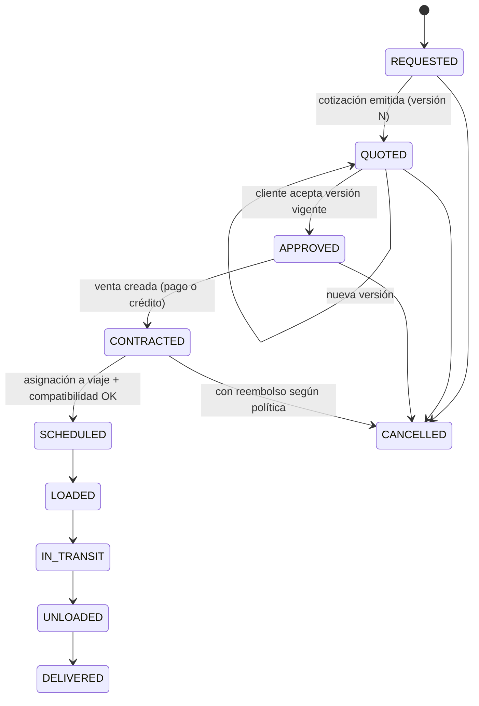

# Flujos principales

## F1. Login y cambio de empresa (D3)

Movido y ampliado en **[identity-and-sessions.md](identity-and-sessions.md)**: hub de cuentas, *authorization code* + PKCE, sesiones por dominio, refresh tokens con rotación y revocación.

## F2. Venta de pasaje por tramo (cualquier canal)

Si la retención expira sin pago, un job pasa la reserva a `EXPIRED` y libera las asignaciones. Un pago que llega tarde (pasarela) sobre una reserva expirada intenta **re-retener**; si no hay disponibilidad, se genera un reembolso automático pendiente de aprobación.

## F3. Recepción y entrega de encomienda con PIN (regla obligatoria)

- La regla se evalúa con el **snapshot** guardado al recibir la encomienda: si la empresa cambia la configuración después, las encomiendas existentes conservan su regla.
- **Reemplazo de PIN:** lo solicita el remitente presentándose con identificación (o mediante un canal verificado definido por la empresa) y lo aprueba un rol con `shipments.pin.reset`. El remitente ingresa el nuevo PIN; el anterior pasa a `REPLACED`. Queda auditado con evidencia. El destinatario nunca puede cambiarlo.

## F4. Traslado entre almacenes con conciliación

- Los ítems son **paquetes** (`shipment_packages`), no encomiendas, porque los bultos de un mismo envío pueden viajar separados.
- Un índice único parcial impide que un paquete esté en dos traslados abiertos a la vez.
- Al recibir, cada escaneo marca `RECEIVED`, `DAMAGED` o `EXTRA`. Al cerrar, lo no escaneado queda `MISSING`. Se generan `tracking_events` y se actualiza `current_location`, que es una caché del último evento. El historial nunca se sobrescribe.
- Si el traslado va en un viaje, consume capacidad de peso y volumen de la bodega por tramo (F2, pools).

## F5. Medición de usuarios y cierre del período de facturación (D5)

Especificación completa (intervalos, zona horaria, SQL, ejemplo y casos especiales) en **[billing.md](../modules/billing.md)**.

## F6. Cotización y asignación de carga especial

## F7. Notificación vía outbox

`tx de negocio + outbox_event` → relay (polling con `FOR UPDATE SKIP LOCKED`) → BullMQ `jobId = eventId` → resolución de plantilla, preferencias y destinatarios → `notification_deliveries` (unique por clave de idempotencia) → Mailgun → estado (`SENT`, `FAILED`, `BOUNCED` vía webhook firmado).
