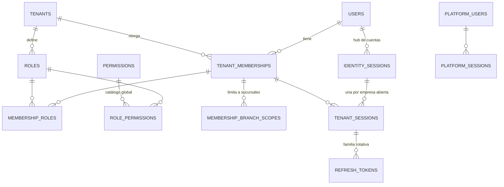
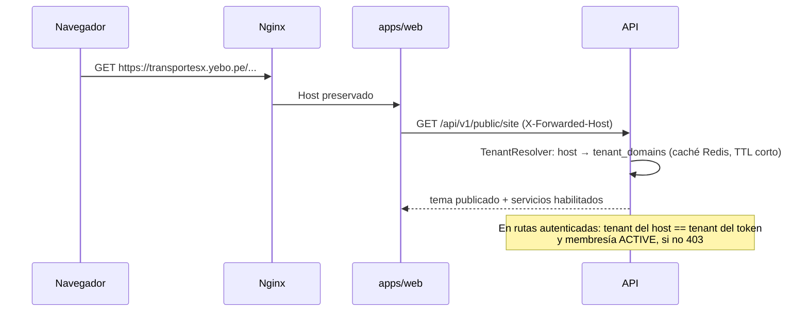

# Multitenancy e identidad

## 1. Modelo de identidad (decisión D3)



- **`users`** es una identidad **global**: correo único (case-insensitive), hash Argon2id, MFA y estado global. Contiene solo los datos de la persona necesarios para autenticarla.
- **`tenant_memberships`** une al usuario con la empresa: estado (`INVITED`, `ACTIVE`, `SUSPENDED`, `REVOKED`), si es facturable, nombre a mostrar en esa empresa, sucursal por defecto e historial de estados.
- Roles y permisos se asignan a la **membresía**, no al usuario. Ser administrador en la empresa A no otorga nada en la empresa B.
- **`platform_users`** (staff de YEBO) es una tabla y un realm de autenticación **separados**. El personal de YEBO no tiene membresías en tenants; el soporte accede mediante **acceso de soporte** temporal, auditado y visible para el tenant (`support_access_grants`).

### 1.1 Consecuencias de la identidad global

| Situación | Regla |
|---|---|
| El admin de la empresa A "crea" un usuario con un correo que ya existe | Se crea una **invitación** de membresía. El usuario la acepta autenticándose. La empresa A no ve si el correo ya existía (respuesta idéntica en ambos casos, contra la enumeración). |
| El admin de la empresa A quiere cambiar el correo o la contraseña de un usuario | **No puede.** Solo puede suspender o revocar la membresía y forzar el cierre de las sesiones *en su tenant*. El correo y la contraseña son del titular. |
| Recuperación de contraseña | Flujo global del titular (no del tenant). El correo usa el branding del host desde el que se solicitó. |
| MFA exigido por la empresa A | Política de tenant: para operar en A, la sesión debe tener MFA verificado. No afecta a B. |
| El usuario abandona la empresa A | La membresía pasa a `REVOKED`. Sus operaciones históricas conservan la referencia a la membresía. |

## 2. Resolución del tenant



Reglas:

1. El tenant **nunca** se acepta desde el cuerpo, la query ni una cabecera controlada por el cliente. `X-Forwarded-Host` solo se confía si viene del proxy (`trust proxy` restringido a la IP de Nginx).
2. **Access token** (JWT de 10 min) con `sub` (user), `sid` (sesión de empresa), `tid` (tenant), `mid` (membresía) y `ver` (versión de permisos de la membresía).
3. En cada request autenticada:
   - El host resuelve el tenant T.
   - El token debe tener `tid = T`.
   - La sesión debe seguir activa y la versión de permisos debe coincidir (Redis, con PostgreSQL como respaldo).
   - El tenant debe permitir la operación según su estado (sección 5).
4. **Login y cambio de empresa**: mediante el hub de cuentas (`cuentas.<dominio>`) con *authorization code* + PKCE. Un clic, sin contraseña, y sin compartir cookies entre dominios. Detalle completo en **[identity-and-sessions.md](identity-and-sessions.md)**.

## 3. Aislamiento en la aplicación

- `TenantContext` en `AsyncLocalStorage` (vía `nestjs-cls`) con `tenantId`, `membershipId`, `userId`, `permissions` y `traceId`.
- **Cliente Prisma con alcance de tenant** (extensión de cliente) que, para modelos marcados como *tenant-scoped*:
  - Inyecta `tenantId` en el `where` de todas las lecturas, actualizaciones y borrados.
  - Fija `tenantId` en la creación y rechaza un `tenantId` distinto del contexto.
  - Lanza `MissingTenantContextError` si no hay contexto. Nunca devuelve todo.
- El acceso sin tenant (resolver de dominios, auth, jobs de plataforma) usa un **cliente Prisma distinto** (`PlatformPrisma`), disponible solo para módulos explícitamente autorizados. Una regla de lint prohíbe importarlo desde módulos de negocio.
- **Protección IDOR**: todo `findUnique` por id se ejecuta como `findFirst({ id, tenantId })`. Además, en recursos con ámbito de sucursal se aplica el `branch scope` de la membresía.

## 4. Aislamiento en la base de datos

### 4.1 Integridad referencial entre tenants

- Toda tabla de tenant tiene `tenant_id uuid NOT NULL` y `UNIQUE (tenant_id, id)`.
- Las FK entre tablas de tenant son **compuestas**: `(tenant_id, route_id) → routes(tenant_id, id)`. Prisma lo soporta con `@relation(fields: [tenantId, routeId], references: [tenantId, id])`. Así la base de datos **impide** que una venta del tenant A apunte a un viaje del tenant B, aunque haya un error en el código.
- Índices: todo índice de búsqueda empieza por `tenant_id`.

### 4.2 Row Level Security (decisión D13: activado desde la Fase 3)

```sql
ALTER TABLE shipments ENABLE ROW LEVEL SECURITY;
ALTER TABLE shipments FORCE ROW LEVEL SECURITY;
CREATE POLICY tenant_isolation ON shipments
  USING (tenant_id = NULLIF(current_setting('app.tenant_id', true), '')::uuid)
  WITH CHECK (tenant_id = NULLIF(current_setting('app.tenant_id', true), '')::uuid);
```

> **ADR-025 (Fase 2):** `NULLIF(..., '')` es necesario porque, en una conexión del *pool* que ya usó `set_config(..., true)`, `current_setting` devuelve `''` y no `NULL`. Sin `NULLIF`, `''::uuid` lanzaría `22P02` en lugar de devolver 0 filas.

| Rol de BD | Uso | RLS |
|---|---|---|
| `yebo_owner` | Migraciones (propietario de las tablas) | No aplica (solo se usa en el despliegue) |
| `yebo_app` | API y worker en contexto de tenant | **Aplica** |
| `yebo_platform` | Resolver de dominios, auth, superadmin, jobs entre tenants (métricas, facturación SaaS) | `BYPASSRLS`, credenciales y *pool* separados |

- La extensión de Prisma envuelve cada operación de tenant en una transacción que primero ejecuta `SELECT set_config('app.tenant_id', $1, true)`. El tercer parámetro, `true`, hace el valor **local a la transacción**, lo que evita fugas entre requests que comparten conexión del *pool*.
- Sin `app.tenant_id`, `current_setting(..., true)` devuelve `NULL` (conexión nueva) o `''` (conexión reutilizada). Con `NULLIF`, en ambos casos la política no devuelve filas y la escritura falla. La falla es segura por defecto.
- Cada transacción fija su tenant explícitamente; el contexto nunca se hereda de una conexión anterior (ADR-025). Están prohibidos `SET`/`SET SESSION`, `set_config(..., false)` y los valores por defecto de rol o base de datos.
- Coste: una transacción por operación. Se medirá en la Fase 3; si penaliza, se agrupan las lecturas de un request en una sola transacción.

### 4.3 Tablas globales (sin `tenant_id`, sin RLS de tenant)

`users`, `platform_users`, `platform_sessions`, `identity_sessions`, `tenant_sessions`, `refresh_tokens`, `authorization_codes`, `permissions`, `modules`, `plans`, `plan_versions`, `plan_version_modules`, `tenants`, `tenant_domains`, `vehicle_type_catalog`, `data_processing_purpose_catalog` y `notification_templates` con `tenant_id IS NULL` (defaults).

`yebo_app` solo tiene `SELECT` sobre las tablas de catálogo. `users`, las sesiones y `tenant_memberships` se gestionan desde el módulo de identidad con `yebo_platform`.

## 5. Estados del tenant y operaciones permitidas

**Principio:** la falta de pago o el vencimiento bloquean **la creación de nuevas obligaciones comerciales**, nunca **el cumplimiento de las ya contraídas** con pasajeros, remitentes y clientes de carga. Esas personas ya pagaron y no son responsables de la deuda de la empresa con YEBO. Impedirles embarcar o recoger su encomienda generaría daño legal y reputacional para la empresa y para YEBO.

### 5.1 Categorías de operación

Cada endpoint de negocio se etiqueta con **una** categoría (`@TenantOperation(...)`). `TenantStatusGuard` la evalúa contra el estado del tenant.

| Categoría | Qué incluye |
|---|---|
| `NEW_COMMERCIAL` | Nuevas reservas y ventas de pasajes (cualquier canal); registro de **nuevas** encomiendas; nuevas solicitudes, cotizaciones y contratos de carga; abrir viajes a la venta; crear viajes o programaciones nuevas; venta de exceso de equipaje |
| `FULFILL` | Embarque y desembarque; confirmar, iniciar, registrar llegada y cerrar viajes **con ventas o traslados comprometidos**; cambio de unidad de esos viajes; manifiestos; **recepción** de encomiendas en almacén o agencia (llegada por traslado); traslados de encomiendas ya registradas; **entrega** (con o sin PIN, incluido el reemplazo autorizado del PIN); carga, descarga y entrega de carga contratada; eventos de tracking; incidencias de viaje y de envío |
| `AFTER_SALES` | Cancelaciones y **devoluciones autorizadas** de ventas existentes; **cobro de saldos pendientes** de ventas existentes (p. ej., encomienda con pago en destino); reprogramación o cambio **sin incremento de precio**; emisión de comprobantes **pendientes** de ventas existentes, notas de crédito, reintentos y anulaciones; **consulta y descarga de comprobantes** (PDF, XML, CDR) |
| `CASH` | Abrir y cerrar caja, arqueos y movimientos vinculados a `AFTER_SALES` o `FULFILL` |
| `READ` | Consultas, reportes y paneles |
| `EXPORT` | Exportaciones administrativas (Excel, PDF, datos personales ante solicitudes ARCO) |
| `CONFIGURE` | Flota, rutas, tarifas, sucursales, white label y roles |
| `CONFIGURE_COMPLIANCE` | Configuración de facturación electrónica y datos fiscales. Se mantiene disponible porque es necesaria para emitir los comprobantes pendientes |
| `USERS_REDUCE` | Suspender o revocar membresías y cerrar sesiones |
| `USERS_ADD` | Invitar o reactivar membresías (aumenta el consumo facturable) |
| `BILLING_SELF` | Ver el estado de cuenta con YEBO, registrar pagos y cambiar de plan |

### 5.2 Matriz (política por defecto)

| Categoría | TRIAL | ACTIVE | PAST_DUE | SUSPENDED | EXPIRED | CANCELLED (periodo de cierre) | CANCELLED (tras el cierre) |
|---|---|---|---|---|---|---|---|
| Login | ✅ | ✅ | ✅ | ✅ todas las membresías activas¹ | ✅ todas¹ | ✅ todas¹ | ❌ |
| `NEW_COMMERCIAL` | ✅ con límites del trial | ✅ | ✅ + aviso | ❌ | ❌ | ❌ | ❌ |
| `FULFILL` | ✅ | ✅ | ✅ | ✅ | ✅ | ✅ | ❌ |
| `AFTER_SALES` | ✅ | ✅ | ✅ | ✅ | ✅ | ✅ | ❌ |
| `CASH` | ✅ | ✅ | ✅ | ✅ | ✅ | ✅ | ❌ |
| `READ` | ✅ | ✅ | ✅ | ✅ | ✅ | ✅ | ❌ |
| `EXPORT` | ✅ | ✅ | ✅ | ✅ | ✅ | ✅ | ✅ solo vía soporte YEBO |
| `CONFIGURE` | ✅ | ✅ | ✅ | ❌ | ❌ | ❌ | ❌ |
| `CONFIGURE_COMPLIANCE` | ✅ | ✅ | ✅ | ✅ | ✅ | ✅ | ❌ |
| `USERS_REDUCE` | ✅ | ✅ | ✅ | ✅ | ✅ | ✅ | ❌ |
| `USERS_ADD` | ✅ dentro del límite | ✅ | ✅ | ❌² | ❌² | ❌ | ❌ |
| `BILLING_SELF` | ✅ | ✅ | ✅ | ✅ | ✅ | ✅ | ❌ |
| Portal público: seguimiento | ✅ | ✅ | ✅ | ✅ | ✅ | ✅ | ❌ |
| Portal público: reservas | ✅ | ✅ | ✅ | ❌ (se muestra aviso, el sitio sigue visible) | ❌ | ❌ | ❌ |
| Notificaciones a clientes finales sobre operaciones existentes | ✅ | ✅ | ✅ | ✅ | ✅ | ✅ | ❌ |

1. Los operadores necesitan entrar para embarcar, recibir y entregar. Lo que pueden hacer dentro lo limita la matriz, no el login.
2. Si hace falta reemplazar a un operador para cumplir obligaciones (p. ej., el único almacenero), YEBO puede otorgar una excepción temporal auditada (`tenant_module_overrides`).

**Transiciones:**
- `TRIAL` → `EXPIRED` al vencer el trial sin pago.
- `ACTIVE` → `PAST_DUE` al vencer una factura.
- `PAST_DUE` → `SUSPENDED` tras **7 días** de gracia sin regularización (aprobado).
- `SUSPENDED` / `EXPIRED` → `ACTIVE` al registrarse el pago (reactivación inmediata).
- `CANCELLED` abre un **periodo de cierre de 30 días** (aprobado) para completar obligaciones y exportar. Después solo queda la exportación vía soporte y, al vencer la retención, la anonimización o purga auditada. Ningún estado borra datos por sí mismo.

### 5.3 Defensa en profundidad

La etiqueta del endpoint puede estar mal puesta. Por eso el **núcleo comercial** aplica además una invariante propia: en `SUSPENDED`, `EXPIRED` y `CANCELLED`:

- No se pueden crear `sales` ni añadir `sale_lines` con importe positivo.
- Los `payments` solo pueden aplicarse a ventas existentes con saldo pendiente.
- Los `refunds` y las notas de crédito siguen permitidos.
- Las nuevas asignaciones de inventario solo se permiten como **reubicación** de una asignación existente (cambio de unidad o reprogramación), nunca como capacidad adicional neta.

Así, una operación "de cumplimiento" que intente generar ingresos nuevos (p. ej., un cambio de fecha con diferencia a pagar) es rechazada por el núcleo con `TENANT_RESTRICTED_NEW_COMMERCIAL`, con un mensaje que explica el motivo.

### 5.4 Configuración

La matriz es el **default** de `plan_versions.suspension_policy` (JSON validado por esquema): días de gracia, duración del periodo de cierre y excepciones. YEBO puede ajustarla por plan; los tenants no. Cada denegación queda en la auditoría con la categoría y el estado del tenant, para poder atender reclamos con evidencia.

**Aprobado el 2026-11-05:** 7 días de gracia en `PAST_DUE` y 30 días de cierre en `CANCELLED`. En `SUSPENDED`, `EXPIRED` y `CANCELLED` **no** se aceptan nuevos envíos, no se venden nuevos pasajes y no se contratan nuevos servicios de carga. Sí se completan las obligaciones existentes: embarcar boletos vendidos, completar viajes, recibir encomiendas en tránsito y registrar su recepción en agencias y almacenes, entregar, cobrar saldos, devolver lo autorizado, emitir comprobantes pendientes y consultarlos o descargarlos. `USERS_ADD` en `SUSPENDED` solo mediante una excepción de YEBO.


## 6. Módulos y servicios habilitados

Lo que una empresa puede usar es la intersección de tres capas:

```
efectivo = módulos del plan contratado (plan_version_modules)
         ∩ servicios/modalidades configurados por la empresa (tenant_services)
         + overrides otorgados por YEBO (tenant_module_overrides, con vigencia)
```

- Guard `@RequiresModule('PARCELS')` en los controladores. El frontend recibe la lista efectiva y oculta lo no habilitado, pero **la autoridad es el backend**.
- Los límites del plan (sucursales, vehículos, almacenamiento) se validan en los servicios al crear recursos.

## 7. Pruebas de aislamiento (criterio de la Fase 3)

1. Por cada endpoint autenticado: un usuario del tenant A con un ID del tenant B debe recibir `404` (no `403`, para no confirmar existencia).
2. Token del tenant A usado en el host del tenant B: `401`/`403`.
3. Usuario con membresía en A y B: con sesión en A no ve datos de B.
4. Consultas directas con `yebo_app` sin `app.tenant_id`: 0 filas.
5. Inserción con FK cruzada entre tenants: violación de FK.
6. Concurrencia: N requests paralelas de tenants distintos sobre el mismo *pool* no mezclan contexto.
7. Test automático que recorre el esquema y falla si una tabla con `tenant_id` no tiene RLS habilitado y forzado.
