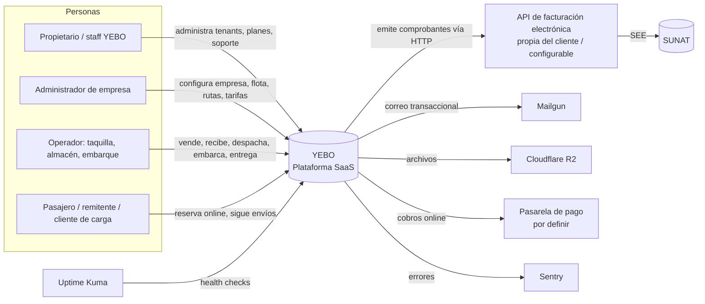
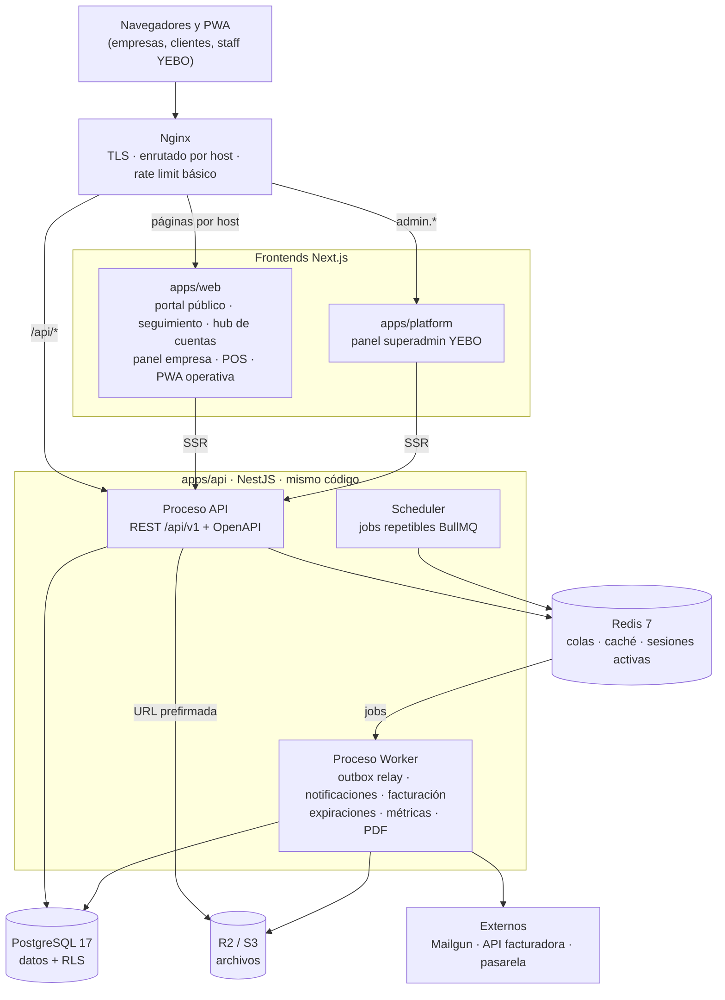
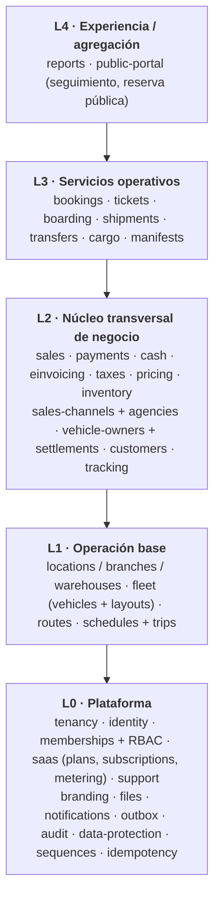
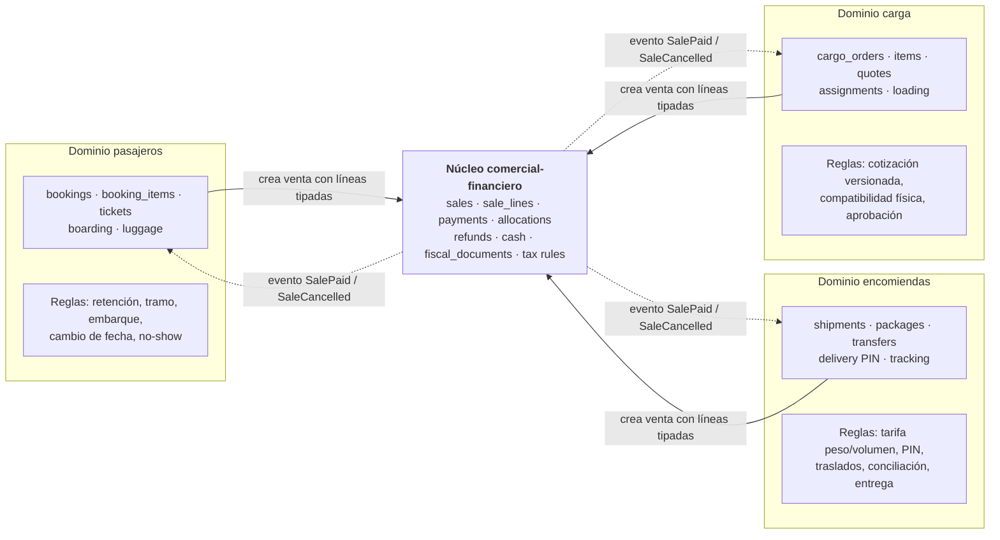

# YEBO — Arquitectura del sistema

- **Fase:** 1 (Arquitectura y diseño), en revisión
- **Documentos relacionados:**
  - [Multitenancy](multitenancy.md)
  - [Identidad, sesiones y cambio de empresa](identity-and-sessions.md)
  - [Seguridad y datos personales](security.md)
  - [Facturación SaaS y medición de usuarios](../modules/billing.md)
  - [Encomiendas: PIN de entrega](../modules/shipments.md)
  - [Inventario y capacidad por tramos](capacity-and-inventory.md)
  - [Flujos principales](main-flows.md)
  - [ADR](architecture-decisions.md)
  - [Modelo ER](../database/entity-relationship.md)
  - [Diccionario de datos](../database/data-dictionary.md)
  - [Facturación electrónica](../modules/electronic-invoicing.md)

---

## 1. Principios

1. **Un núcleo, varias modalidades.** Terrestre (`LAND`) y fluvial (`RIVER`) son configuración, no código distinto. Pasajeros, encomiendas, carga y vehículos son **servicios** que una empresa activa.
2. **PostgreSQL es la fuente de verdad** del inventario, del dinero y de los estados. Redis solo actúa como caché y como transporte de colas.
3. **Tres estados independientes** por operación comercial: el estado **operativo** (boleto, encomienda, carga), el **comercial** (venta y saldo) y el **fiscal** (comprobante electrónico). Ninguno bloquea a los otros.
4. **Inmutabilidad de lo histórico.** Las operaciones guardan *snapshots* de tarifas, layouts, impuestos y datos del cliente. Una configuración nueva nunca reescribe operaciones pasadas.
5. **Aislamiento por defecto.** Toda consulta de negocio corre en un contexto de tenant validado. Sin contexto, la consulta falla; no devuelve datos vacíos.
6. **Efectos externos fuera de la transacción.** Correos, facturación electrónica y webhooks se ejecutan vía outbox y colas.
7. **Configurable, no hardcodeado.** Planes, precios, impuestos, permisos de rol, tarifas, endpoints de facturación y políticas de retención se guardan como datos.

## 2. C4 — Nivel 1: contexto



## 3. C4 — Nivel 2: contenedores



| Contenedor | Responsabilidad | No hace |
|---|---|---|
| `apps/web` | UI de la empresa y de sus clientes. Resuelve el tema por host vía API. | No accede a la base de datos ni guarda secretos. |
| `apps/platform` | UI de administración SaaS, en dominio propio (`admin.yebo.pe`, por definir). | No comparte cookies con los dominios de tenants. |
| API | Reglas de negocio, autorización, transacciones. | No llama a servicios externos dentro de transacciones de negocio. |
| Worker | Efectos asíncronos, reintentos, jobs periódicos. | No expone HTTP público, solo un endpoint de health interno. |
| PostgreSQL | Verdad única: inventario, dinero, estados, auditoría. | — |
| Redis | Colas BullMQ, caché de lecturas, contadores de rate limit. | No es inventario ni sesión autoritativa. |

## 4. C4 — Nivel 3: módulos del backend

### 4.1 Mapa de módulos por capa

Una capa puede depender de las inferiores, nunca de las superiores.



### 4.2 Reglas de dependencia

- Un módulo solo expone **servicios de aplicación** y **tipos de contrato**. Nunca expone repositorios ni modelos Prisma a otros módulos.
- La comunicación hacia "abajo" es por llamada directa al servicio público del módulo. La comunicación hacia "arriba" o lateral, cuando no debe acoplarse, es por **evento de dominio**. Ejemplo: `ShipmentDelivered` → `notifications`, `tracking`.
- `sales`, `payments`, `einvoicing` y `inventory` no conocen boletos, encomiendas ni carga. Reciben líneas genéricas con una referencia de origen tipada.
- Se validará con una regla de lint (`eslint-plugin-boundaries` o `dependency-cruiser`) en la Fase 2.

### 4.3 Estructura interna de cada módulo

```
modules/shipments/
  shipments.module.ts
  application/      casos de uso (un servicio por agregado o caso, no servicios gigantes)
  domain/           entidades puras, reglas, máquinas de estado, errores de dominio
  infrastructure/   repositorios Prisma, adaptadores
  http/             controladores, mapeo DTO ↔ contrato
  events/           eventos publicados y handlers suscritos
```

Las **máquinas de estado** (boleto, encomienda, traslado, carga, comprobante, tenant y suscripción) se definen en `domain/` como tablas de transición explícitas y probadas de forma unitaria.

## 5. Modelo conceptual unificado

### 5.1 Núcleo compartido frente a dominios operativos (ADR-014)

Lo que se **comparte** es el núcleo **comercial y financiero**: dinero vendido, cobrado, devuelto, en caja y facturado. Lo que **no** se comparte es la operación. Pasajeros, encomiendas y carga conservan sus propias entidades, reglas y máquinas de estado.



| El núcleo comercial **sí** sabe | El núcleo comercial **no** sabe |
|---|---|
| Importes, moneda, impuestos por línea, descuentos | Qué es un asiento, un tramo, un bulto o un PIN |
| Pagos, saldos, asignación de pagos a ventas | Si un boleto puede reprogramarse o una encomienda entregarse |
| Reembolsos **ya autorizados por el dominio** (importe y método) | La política de reembolso (la calcula el dominio y entrega el importe) |
| Caja, arqueos y diferencias | Estados operativos (`BOARDED`, `IN_TRANSIT`, `DELIVERED`…) |
| Emisión del comprobante a partir de las líneas | Cómo se cotiza ni cómo se tarifa |
| El **tipo** de origen de cada línea (`booking_item`, `shipment`, `cargo_order`…) para trazabilidad | Ninguna regla del origen |

Reglas de diseño:

1. **No existe una entidad genérica "Operación" ni "Servicio"** que concentre lógica. `sale_lines` solo guarda una FK tipada al origen para trazabilidad e integridad. No contiene campos operativos.
2. Cada dominio **decide**: calcula el precio con su motor de tarifas, decide si una cancelación procede y cuánto se reembolsa, y cuándo una venta pagada habilita la operación (boleto emitido, encomienda aceptada, carga contratada).
3. El núcleo **notifica** (`SalePaid`, `SaleCancelled`, `RefundPaid`) y cada dominio reacciona con su propia máquina de estados.
4. La única interfaz que el dominio implementa para el núcleo es de **lectura descriptiva** (descripción de la línea para el comprobante y el código de concepto tributario). No hay *callbacks* con lógica.
5. Si mañana se añade un servicio nuevo (p. ej., alquiler de unidades), se crea **su** módulo y un nuevo tipo de origen en `sale_lines`. El núcleo no cambia de comportamiento.

### 5.2 Entidades consolidadas

Estas decisiones evitan entidades duplicadas respecto a la lista del requerimiento:

| Requerimiento | Diseño YEBO | Motivo |
|---|---|---|
| `Passenger`, `ShipmentParty` (remitente/destinatario), clientes de carga | **`customers`** (por tenant) + *snapshot* en cada operación | Una persona es un cliente; su rol depende de la operación. El *snapshot* conserva lo que se declaró en ese momento. |
| `TicketPayment`, `ShipmentPayment`, pagos de carga | **`sales` + `sale_lines` + `payments` + `payment_allocations`** | Solo se consolida el registro **financiero**: valor vendido, dinero recibido, caja y facturación. Las entidades operativas (`tickets`, `shipments`, `cargo_orders`) y sus reglas permanecen en su dominio (sección 5.1). |
| `ShipmentTrackingEvent`, `CargoTrackingEvent` | **`tracking_events`** con sujeto tipado | Mismo comportamiento: historial *append-only* y proyección pública. |
| `PassengerManifest`, `CargoManifest`, manifiestos de encomiendas y de vehículos | **`manifests`** con `type` + *snapshot* | Mismo ciclo: generar, emitir, versionar y PDF. |
| `SeatDefinition`, `VehicleZone`, `ZoneResource` | **`layout_elements`** + **`layout_zones`** | Asiento, cama, camarote y espacio de vehículo son elementos con `kind`; las zonas agrupan capacidad. |
| `TripLayoutSnapshot` | Versión de layout **inmutable** + inventario materializado (`trip_resources`, `trip_capacity_pools`) | La versión publicada no cambia; el viaje la referencia y materializa su inventario operativo. |
| `TenantBranding`, `TenantTheme`, `TenantPage` | **`site_versions`** (documento de configuración versionado y validado) | Publicar y restaurar de forma atómica. |
| `ShipmentRate` | **`rate_tables`** versionadas + `rate_rules` | También sirven para la carga. |
| `Invoice` (SaaS) y comprobante electrónico | **`platform_invoices`** (YEBO → empresa) y **`fiscal_documents`** (empresa → su cliente) | Son dominios distintos con emisores distintos. |

## 6. Estrategias transversales

### 6.1 Eventos

- **Eventos de dominio en proceso** (`@nestjs/event-emitter` o un bus propio tipado) para reacciones internas dentro de la misma transacción o justo después de ella.
- **Outbox transaccional** (`outbox_events`) para todo evento con efecto externo o que deba sobrevivir a caídas. La fila se inserta en la misma transacción que el cambio de negocio. El worker la publica en BullMQ con `jobId = outbox_event.id` (deduplicación) y la marca como publicada.
- Los eventos llevan `tenantId`, `eventId`, `occurredAt`, `schemaVersion` y un *payload* mínimo (IDs, no datos personales).
- Los consumidores son **idempotentes** (registro de procesados por `eventId` + consumidor).

### 6.2 Notificaciones

- El evento llega al `NotificationModule`, que resuelve la plantilla (override del tenant → default de la plataforma), las preferencias y los destinatarios, y crea la `notification_delivery`. Después se encola en BullMQ y el `EmailProvider` (Mailgun) la envía.
- Clave de idempotencia por entrega: `eventId + canal + destinatario + plantilla`.
- Reintentos con *backoff* exponencial; los errores permanentes (4xx del proveedor) no se reintentan.
- Plantillas con un lenguaje **sin lógica** (estilo Mustache, con *escape* obligatorio). Los tenants no pueden inyectar HTML arbitrario ni scripts.
- Lista de bloqueo de campos: el PIN de entrega y los documentos completos nunca están disponibles en el contexto de plantillas.
- Los canales `WHATSAPP` y `SMS` se reservan en el modelo, sin implementar.

### 6.3 Almacenamiento de archivos

- R2 con claves `tenants/{tenantId}/{dominio}/{uuid}.{ext}`, nunca derivadas del nombre original.
- Subida en dos pasos: la API emite una URL prefirmada con tamaño y tipo restringidos, el cliente sube el archivo y la API confirma, verificando tamaño, *magic bytes* y *checksum*.
- SVG: se sanitiza (DOMPurify en servidor) o se rasteriza. Nunca se sirve SVG del tenant desde el dominio de la aplicación sin `Content-Security-Policy` restrictiva.
- Descarga de archivos privados mediante URL prefirmada de corta duración, tras autorización.
- Los PDF, XML y CDR fiscales se obtienen de la API facturadora. YEBO puede guardar una **copia en caché** con su *checksum* para disponibilidad, siempre marcando el origen.

### 6.4 Auditoría

- `audit_logs` *append-only* (el rol de la aplicación no tiene `UPDATE` ni `DELETE`), particionada por mes.
- Registra actor (usuario, membresía, staff de plataforma, sistema o servicio), acción, entidad, diff redactado, IP, agente de usuario y `traceId`.
- Acciones sensibles obligatorias: login, cambio de rol, ver un dato personal completo, reset de PIN, anulación, reembolso, cierre de caja, cambio de configuración fiscal, suspensión de tenant y acceso de soporte a un tenant.

### 6.5 Despliegue (dirección; detalle en la Fase 15)

- Docker Compose en un VPS para el MVP: `nginx`, `api` (N réplicas), `worker`, `web`, `platform`, `postgres`, `redis`. PostgreSQL gestionado cuando el volumen lo justifique.
- Migraciones Prisma ejecutadas como paso explícito del despliegue, nunca al arrancar la API.
- Subdominios con certificado *wildcard* (DNS-01). Los dominios propios quedan fuera del MVP (decisión D11).
- Backups: `pg_dump` diario + WAL (pgBackRest o equivalente) hacia R2, con pruebas de restauración periódicas.

## 7. Supuestos y puntos por validar

| # | Supuesto o punto abierto | Origen | Efecto si cambia |
|---|---|---|---|
| S1 | Aún no hay cliente piloto definido. El orden de habilitación de módulos se ajustará cuando exista. | D1 | Prioridad de fases, no el modelo. |
| S2 | Contrato de la API de facturación desconocido: si YEBO asigna el correlativo o lo asigna la API, el formato del *payload*, el formato de los errores, si permite anulación y comunicación de baja, y si hay entorno de pruebas. | D2 | Adaptador y `document_series`. El modelo soporta ambas opciones. |
| S3 | Esquemas de liquidación con propietarios de vehículos: solo se modela un catálogo de esquemas parametrizables. | D6 | Nuevos esquemas = nuevo código de esquema, sin migración estructural. |
| S4 | Comisiones de agencias externas: porcentaje o monto fijo por servicio y vigencia. | D7 | Nuevas reglas = nuevos tipos en `agency_commission_rules`. |
| S5 | Tratamiento tributario (IGV, exoneraciones, inafectaciones, régimen amazónico) a validar con un contador. | Impuestos | Solo datos de configuración. |
| S6 | Formato oficial de manifiestos MTC/SUTRAN y de zarpe DICAPI. | Riesgo N2 | Plantillas de manifiesto, no el modelo. |
| S7 | Pasarela de pago online por definir. | D9 | Adaptador `PaymentProvider`. |
| S8 | El dominio de la plataforma se asume como `yebo.pe` solo en los ejemplos. | D12 | Configuración. |
