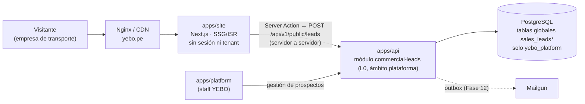
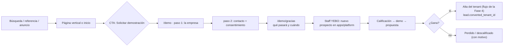

# MKT-01 — Sitio web comercial de YEBO

- **Estado:** ✅ Propuesta aprobada (2026-11-05): ADR-027 y ADR-028 aceptados y dominio `yebo.pe` aprobado (MKT-D1 a MKT-D6). **No hay nada implementado** y la implementación no está autorizada (etapas MKT-01.1 y siguientes).
- **Tipo:** iniciativa transversal e independiente. No es una fase del roadmap y no renumera ni modifica ninguna.
- **No confundir con:**
  - el **White Label** (Fase 5): el sitio público de *cada empresa cliente*, en su propio dominio (`site_versions`);
  - los **portales públicos** (Fase 13): la reserva y el seguimiento de los pasajeros y remitentes de cada empresa.

  MKT-01 es el sitio corporativo de **YEBO como producto SaaS** y su único objetivo es captar empresas de transporte como clientes.
- **Documentos relacionados:**
  - [Metodología de diseño](../design/design-methodology.md)
  - [Roadmap](../development/roadmap.md#iniciativas-transversales)
  - [ADR-027 y ADR-028 (aceptados)](../architecture/architecture-decisions.md#adr-de-la-iniciativa-mkt-01-aceptados-el-2026-11-05)
  - [Registro de cambios](../development/changelog.md)

---

## 1. Principio rector: no prometer lo que no existe

Hoy **ninguna funcionalidad de negocio está implementada**: la Fase 2 entregó la fundación técnica. Por eso el sitio:

1. Muestra cada capacidad con un **estado explícito**, que sale de un único archivo de datos versionado y no del texto de cada página:

   | Estado | Significado | Requisito para usarlo |
   |---|---|---|
   | **Disponible** | En producción y utilizable por un cliente | La fase que la entrega está cerrada y aprobada |
   | **Próximamente** | En desarrollo activo | Su fase está en curso. Sin fecha pública |
   | **Planificada** | Está en el roadmap | Aparece en `roadmap.md` |

2. No publica capturas simuladas presentadas como reales. Hasta que existan pantallas reales (Fases 8–10), usa ilustraciones conceptuales rotuladas como tales.
3. No publica testimonios, clientes, cifras de uso ni valoraciones inexistentes. Tampoco usa `aggregateRating` en los datos estructurados.
4. No afirma cumplimiento normativo (SUNAT, SUTRAN, MTC, DICAPI) que no esté validado. Los supuestos S2, S5 y S6 siguen abiertos.

Estado de partida de cada capacidad (se actualiza al cerrar cada fase):

| Capacidad | Fase que la entrega | Estado actual |
|---|---|---|
| Multitenancy, seguridad y aislamiento | 3 | Planificada |
| Superadmin, planes y membresías | 4 | Planificada |
| Sitio y marca propios de la empresa (white label) | 5 | Planificada |
| Sucursales, agencias, flota y capacidades (camarotes, bodega, cubierta) | 6 | Planificada |
| Rutas multiparada, programación y viajes | 7 | Planificada |
| Pasajeros y boletos, sin doble venta | 8 | Planificada |
| Encomiendas, traslados y PIN de entrega | 9 | Planificada |
| Carga, vehículos y maquinaria | 10 | Planificada |
| Caja, pagos, reportes y facturación electrónica | 11 | Planificada |
| Notificaciones por correo | 12 | Planificada |
| Reserva en línea y seguimiento de encomiendas | 13 | Planificada |
| Operación sin conexión | 14 | Planificada |
| Canales, agencias externas y propietarios de vehículos | Módulos D6/D7 | Planificada, **pendiente de validación comercial** (no se anuncia hasta validarla) |

## 2. Arquitectura propuesta

### 2.1 Opciones evaluadas

| Criterio | A · Ruta dentro de `apps/web` | **B · Nueva app `apps/site` (recomendada)** | C · Sitio externo (constructor web o CMS SaaS) |
|---|---|---|---|
| Encaje con ADR-002 | Total | Añade una app → **requiere ADR-027** | Fuera del monorepo |
| Contexto | Mezcla el marketing con el *middleware* que resuelve el tenant por host, la sesión y la CSP de las apps privadas | Aislado: sin tenant, sin sesión, sin cookies de aplicación | Aislado |
| SEO y rendimiento | El bundle y los despliegues del producto afectan al sitio | Páginas estáticas (SSG/ISR), JS mínimo y presupuesto de rendimiento propio | Variable; poco control de Core Web Vitals |
| Despliegue | Cada publicación de contenido redespliega la app operativa | Independiente | Independiente |
| Reutilización | Total | Tokens y componentes de `packages/ui` | Ninguna |
| Stack aprobado | Sí | Sí (Next.js 16, mismo monorepo) | **No** |

**Recomendación: B.** El sitio comercial tiene otro público, otro ciclo de publicación y otros requisitos (SEO, CDN, sin autenticación) que los paneles. Separarlo evita que un error en el sitio afecte a la operación de las empresas, y al revés. **No cambia el stack:** es otra app Next.js del mismo monorepo. Como ADR-002 enumera las apps, esto se propone como **ADR-027** y no se aplica sin aprobación (§7).

### 2.2 Diseño de `apps/site` (ADR-027 aceptado; sin implementar)

- **Dominio:** `yebo.pe` como canónico (**aprobado**, MKT-D5), con `www.yebo.pe` redirigido (301). Antes del despliegue quedan por verificar la titularidad, la disponibilidad y la configuración DNS.
- **Renderizado:** React Server Components y generación estática. Solo es interactivo en el cliente el formulario de demostración.
- **Contenido:** MDX en el repositorio (páginas y artículos) con revisión por PR. No se usa CMS al inicio; se reevaluará si el ritmo editorial lo exige.
- **Reutilización:** `packages/ui` (tokens y primitivas accesibles) y `packages/contracts` (esquema Zod del prospecto, ADR-006). **No** reutiliza los layouts ni la navegación de los paneles.
- **Seguridad:**
  - CSP estricta;
  - el formulario envía servidor a servidor, así que el navegador no llama a la API y no se amplía CORS;
  - rate limit, CAPTCHA (como exige `security.md` para formularios abusables) y campo trampa (honeypot).
- **Independencia de los tenants:** `apps/site` nunca resuelve tenants ni lee `tenant_domains`, y no comparte cookies.

### 2.3 Hallazgo: subdominios reservados (adición propuesta a la Fase 4)

Los tenants usan `<empresa>.yebo.pe`, y la plataforma ya usa `cuentas.` y `admin.`. `tenant_domains` no define una **lista de subdominios reservados**. Sin ella, una empresa podría registrar `www`, `blog` o `api`.

**Requisito aprobado de la Fase 4 (MKT-D6):** reservar al menos `www`, `app`, `cuentas`, `admin`, `api`, `blog`, `ayuda`, `docs`, `estado`, `status`, `mail`, `demo` y `static`, más los demás nombres internos que se identifiquen, validados al crear el tenant. Es una adición: no cambia ninguna decisión.

## 3. Estructura de páginas

Criterio: una página existe solo si responde a una **intención de búsqueda o de compra distinta**. No se crean páginas por ciudad ni variantes por palabra clave.

| URL | Propósito | Intención principal | Prioridad |
|---|---|---|---|
| `/` | Propuesta de valor, problemas, capacidades, modalidades, CTA | Navegacional y comercial | Lanzamiento |
| `/transporte-terrestre` | Buses interprovinciales y urbanos: boletos, asientos, agencias, encomiendas en bodega | Comercial ("sistema de venta de pasajes") | Lanzamiento |
| `/transporte-fluvial` | Embarcaciones: camarotes, zona libre, bodega, cubierta, tramos con paradas intermedias | Comercial (nicho con poca competencia) | Lanzamiento |
| `/encomiendas` | Recepción, traslados, seguimiento, PIN de entrega | Comercial ("sistema de encomiendas") | Lanzamiento |
| `/carga` | Carga general, vehículos y maquinaria con validación de capacidad | Comercial | Lanzamiento |
| `/funcionalidades` | Catálogo completo con el estado de cada capacidad (§1) | Investigación | Lanzamiento |
| `/demo` | Solicitud de demostración (§5) | Conversión | Lanzamiento |
| `/demo/gracias` | Confirmación y próximos pasos (`noindex`) | — | Lanzamiento |
| `/preguntas-frecuentes` | Dudas de compra: implantación, datos, facturación, conexión, soporte | Investigación | Lanzamiento |
| `/privacidad`, `/terminos`, `/cookies` | Textos legales, validados por un asesor legal (Ley 29733) | — | Lanzamiento (obligatorias) |
| `/precios` | Modelo de precios por usuarios (D5) | Comercial | **Cuando existan los planes publicados** (Fase 4). Antes: "precio según tamaño, solicita demo" |
| `/recursos/<slug>` | Artículos informativos (§4.5) | Informacional | Tras el lanzamiento, de forma continua |
| `/nosotros` | Equipo, misión, ubicación y contacto | Confianza | Cuando haya contenido real |
| `/contacto` | **No se crea por separado:** el contacto general vive en `/demo` (con un motivo seleccionable) y en el pie de página | — | — |

Se descartan una página "Soluciones" independiente (es un menú, no una página) y las páginas por ciudad o país sin contenido diferenciado.

## 4. Estrategia SEO

### 4.1 Palabras clave (hipótesis por validar)

> No se publican volúmenes de búsqueda inventados. Estos grupos son **hipótesis** que se validan con Google Keyword Planner, Search Console (cuando haya datos) y el análisis de los resultados reales antes de redactar.

| Grupo | Términos semilla (es-PE) | Variantes LATAM | Página destino | Riesgo de intención |
|---|---|---|---|---|
| Terrestre | software para empresas de transporte, sistema de venta de pasajes, sistema de boletaje, software de transporte interprovincial | sistema de venta de boletos (MX, AR), venta de tiquetes (CO) | `/transporte-terrestre` | "venta de pasajes" sin "sistema" o "software" es intención de viajero (B2C): se excluye |
| Fluvial | software para transporte fluvial, sistema para embarcaciones, venta de pasajes para lanchas | — | `/transporte-fluvial` | Búsquedas de rutas ("lancha Iquitos Yurimaguas") son B2C |
| Encomiendas | sistema de encomiendas, software de encomiendas, gestión de encomiendas para agencias | paquetería (MX), envíos (CL, AR) | `/encomiendas` | "seguimiento de encomiendas" es del remitente: lo atienden los portales de cada empresa (Fase 13) |
| Carga | software de gestión de carga, sistema de transporte de carga | — | `/carga` | Competencia con TMS de logística pesada |
| Transversal | facturación electrónica para empresas de transporte, manifiesto de pasajeros, control de caja de agencias | — | `/funcionalidades`, `/recursos/*` | Contenido regulatorio: requiere validar S2, S5 y S6 |

Mercado: **Perú primero** (`es-PE`). Se añadirán `hreflang` y variantes por país solo cuando exista contenido realmente adaptado (moneda, normativa, terminología); traducir palabras sueltas no basta.

### 4.2 SEO on-page

- Un `<title>` y una `meta description` únicos por página, definidos en el archivo de contenido y validados en build (longitud y unicidad).
- Un solo `h1` por página; la jerarquía de encabezados sigue el contenido.
- URLs en español, en minúsculas, con guiones y sin parámetros (las de §3).
- Enlazado interno: cada página vertical enlaza `/funcionalidades`, `/demo` y los artículos de su grupo.
- `alt` descriptivo en las imágenes con contenido; vacío en las decorativas.

### 4.3 SEO técnico

| Elemento | Implementación |
|---|---|
| Sitemap XML | `app/sitemap.ts`, generado del contenido; excluye las páginas `noindex` |
| robots.txt | `app/robots.ts`. En los entornos que no son de producción, `Disallow: /` y además `X-Robots-Tag: noindex` |
| Canonical | Absoluta en cada página, con el dominio canónico único |
| Open Graph y X Cards | `metadata` por página e imagen OG generada (`opengraph-image`) con el título de la página |
| Schema.org | `Organization` y `WebSite` en el inicio; `SoftwareApplication` en `/funcionalidades` (sin valoraciones ni precios inventados); `BreadcrumbList` en las verticales; `Article` en `/recursos/*`; `FAQPage` en preguntas frecuentes (válido como marcado, aunque Google hoy limita ese resultado enriquecido a sitios gubernamentales y de salud) |
| Core Web Vitals | Objetivos en el percentil 75 móvil: LCP < 2,5 s, INP < 200 ms, CLS < 0,1. Presupuesto: ≤ 70 KB de JS en las páginas de contenido. Lighthouse CI en cada PR del sitio |
| Imágenes | `next/image`, AVIF/WebP, dimensiones explícitas, `priority` solo en la imagen LCP y carga diferida en el resto |
| Fuentes | Autoalojadas con `next/font` y subconjunto latino; como máximo 2 familias |
| Accesibilidad | WCAG 2.2 AA; axe en CI; navegación completa por teclado |
| Analítica | Herramienta respetuosa con la privacidad (sin cookies, o con consentimiento previo si usa cookies), eventos de conversión (`demo_started`, `demo_submitted`) y UTM. Se elige en la implementación |
| Search Console | Verificación por DNS TXT, envío del sitemap y alertas de cobertura. También Bing Webmaster Tools |

### 4.4 Errores que se evitan

- Contenido duplicado entre las verticales: cada una describe la operación propia de su modalidad.
- Páginas de entorno de pruebas indexadas.
- Texto en imágenes.
- *Keyword stuffing*.
- Afirmaciones sin respaldo.

### 4.5 Estrategia de contenidos

Artículos útiles para el operador, no para "posicionar". Cada artículo resuelve un problema real y se revisa antes de publicarse. Primeras propuestas:

1. Cómo evitar la doble venta de asientos en rutas con paradas intermedias. YEBO tiene evidencia propia: la PoC 2.
2. Cómo controlar las encomiendas entre agencias sin perder trazabilidad.
3. Capacidad en embarcaciones: camarotes, zona libre, bodega y cubierta.
4. Facturación electrónica en empresas de transporte. **Requiere validar S5 con un contador.**
5. Manifiestos de pasajeros y de carga. **Requiere validar S6.**

Ritmo propuesto: 1–2 artículos al mes después del lanzamiento. Cada uno lleva fecha de actualización y autor real.

## 5. Flujo de captación de prospectos

### 5.1 Recorrido

### 5.2 Datos del formulario (mínimos, en dos pasos)

| Paso | Campo | Tipo | Obligatorio |
|---|---|---|---|
| 1 · Empresa | Nombre de la empresa | texto | Sí |
| | Modalidad | Terrestre / Fluvial / Ambas | Sí |
| | Servicios | Pasajeros, encomiendas, carga, vehículos (selección múltiple) | Sí |
| | Tamaño | Rangos: sucursales o agencias; usuarios que operarían el sistema (base del modelo de cobro D5); viajes por semana | Sí (rangos, no cifras exactas) |
| | Región o ciudad principal | lista | Sí |
| | RUC | texto validado | No |
| 2 · Contacto | Nombre y cargo | texto | Sí / No |
| | Correo de trabajo | email | Sí |
| | Teléfono o WhatsApp | teléfono | Sí |
| | Motivo | Demo / Precios / Otra consulta | Sí (por defecto, Demo) |
| | Mensaje | texto | No |
| | Aceptación de la política de privacidad (informativa) | casilla | Sí |
| | Autorización para recibir comunicaciones comerciales | casilla **separada**, desmarcada | No |

También se guardan, sin pedirlos: la página de origen, los UTM del primer contacto, la fecha y la versión del texto de privacidad aceptado.

### 5.3 Seguimiento comercial

- Estados: `NEW → CONTACTED → QUALIFIED → DEMO_SCHEDULED → PROPOSAL_SENT → WON | LOST | DISQUALIFIED`, con el motivo obligatorio en `LOST` y `DISQUALIFIED`.
- Historial: cada cambio y cada nota queda en `sales_lead_events` (append-only).
- Asignación a un miembro del staff, fecha del próximo paso y alerta de los prospectos sin contacto en 1 día hábil.
- Al ganar, el alta del tenant usa el flujo normal de la Fase 4. El prospecto queda enlazado (`converted_tenant_id`), pero sus datos **no** se copian al tenant.

### 5.4 ¿Módulo comercial independiente de los tenants? Sí (ADR-028, aceptado)

| Opción | Ventajas | Inconvenientes |
|---|---|---|
| **Módulo `commercial-leads` en la API, ámbito plataforma (recomendada)** | Datos bajo control de YEBO y en el mismo marco de seguridad, auditoría y Ley 29733; enlace directo con el alta del tenant | Construir un CRM mínimo |
| CRM externo (HubSpot, Pipedrive…) | Funcionalidad comercial inmediata | Transferencia de datos personales al extranjero (Ley 29733), coste y dependencia; aun así haría falta el enlace con el alta del tenant |

**Recomendación:** un módulo propio y mínimo en la capa L0 (plataforma), con un puerto `CrmExporter` (ADR-012) para integrar un CRM más adelante si hace falta.

Reglas:

- **Tablas globales** sin `tenant_id` (`sales_leads`, `sales_lead_events`), fuera del acceso de los tenants. `yebo_app` no recibe permisos. El acceso se hace mediante un servicio de plataforma con un rol de BD de privilegios mínimos, y el aislamiento se verifica en PostgreSQL. Condiciones completas en ADR-028.
- No mezclan datos de prospectos con datos operativos de ningún tenant.
- Datos personales:
  - minimización;
  - cifrado de campo del teléfono y el correo, según el principio de ADR-019;
  - retención propuesta de 24 meses sin actividad y luego anonimización;
  - registro del consentimiento comercial separado.

## 6. Dependencias con las fases actuales

| Fase | Relación con MKT-01 | Tipo |
|---|---|---|
| 2 · Fundación técnica (en PR) | Monorepo y CI donde vivirá `apps/site` | Requisito cumplido al cerrar el PR |
| 3 · Multitenancy y seguridad | Rate limit, CAPTCHA y auditoría para el endpoint público de prospectos | **Bloqueante** para el formulario |
| 4 · Superadmin y membresías | Gestión de prospectos en `apps/platform`; alta del tenant al ganar; planes para `/precios`; subdominios reservados (§2.3) | **Bloqueante** para el flujo comercial completo |
| 5 · White label | Comparte `packages/ui`. Los tokens de YEBO y los temas de los tenants deben convivir ([metodología §4](../design/design-methodology.md)) | Coordinación |
| 8, 9, 10 · Verticales | Capturas reales y paso de "Planificada" a "Disponible" | Contenido |
| 12 · Mailgun | Aviso al staff y confirmación al prospecto por correo (antes, solo aviso en el panel) | Mejora |
| 13 · Portales públicos y UX | Patrones públicos compartidos; **sin** solapamiento de dominios | Coordinación |
| 15 · Producción | Despliegue de `apps/site`, CDN, Search Console y monitorización | **Bloqueante** para publicar |

Decisiones externas: hosting (D12; el dominio `yebo.pe` ya está aprobado, a falta de verificar titularidad y DNS), identidad de marca (solo hay una dirección preliminar, MKT-D4), textos legales validados por un asesor y validación de las palabras clave con datos reales.

## 7. Conflictos con decisiones aprobadas

| # | Conflicto o vacío | Decisión afectada | Recomendación | Estado |
|---|---|---|---|---|
| K1 | ADR-002 define dos apps (`web`, `platform`). `apps/site` sería una tercera | ADR-002 | ADR-027 **amplía** ADR-002 sin cambiar las responsabilidades de `web` ni de `platform` | ✅ Resuelto: ADR-027 aceptado |
| K2 | El C4 nivel 2 enruta las "páginas por host" a `apps/web`; no contempla el dominio raíz | system-overview §3 | Con ADR-027 aceptado, añadir `yebo.pe` → `apps/site` como **adición** al diagrama cuando se implemente MKT-01.2 | Pendiente para MKT-01.2; el diagrama aprobado no se toca hasta entonces |
| K3 | Las tablas de prospectos no figuran en la lista de tablas globales | multitenancy §4 (lista de tablas globales) | ADR-028 las añade como globales solo de plataforma | ✅ Resuelto: ADR-028 aceptado. La lista de multitenancy §4 se actualizará al implementarlas (Fase 4) |
| K4 | Faltan subdominios reservados | `tenant_domains` (diccionario de datos) | Adición a la Fase 4 (§2.3) | ✅ Requisito aprobado de la Fase 4 (MKT-D6) |
| K5 | Impeccable no estaba instalada | — | Ver [metodología §1](../design/design-methodology.md) | ✅ Instalada en el proyecto mediante el PR #3 (npm, `--no-hooks`, telemetría desactivada) |

Ningún ADR aceptado se modifica.

## 8. Plan de trabajo y criterios de aceptación

| Etapa | Contenido | Entregables | Criterio de aceptación | Cuándo |
|---|---|---|---|---|
| **MKT-01.0 · Estrategia** | Este documento; identidad de marca; validación de las palabras clave; dominio (`yebo.pe` aprobado, MKT-D5; verificación DNS pendiente) | Propuesta aprobada; ADR-027/028 decididos; marca definida | Aprobación del responsable | **Ahora**, solo documentación (en paralelo; no toca la Fase 3) |
| **MKT-01.1 · Fundamentos de diseño** | Tokens y primitivas de `packages/ui`; Skill `yebo-design-system` | Tokens versionados; Skill en el repositorio | Contraste AA verificado automáticamente; tema de prueba de un tenant que no rompe la accesibilidad | Al inicio de la Fase 4 (primera UI real) |
| **MKT-01.2 · Sitio y captación** | `apps/site` con las páginas de lanzamiento; formulario; módulo `commercial-leads`; gestión en `apps/platform` | Sitio en preproducción (`noindex`); pruebas E2E del formulario | LCP < 2,5 s, INP < 200 ms y CLS < 0,1 (p75 móvil, laboratorio); axe sin errores; metadatos únicos; sitemap válido; rate limit y CAPTCHA probados; ningún prospecto visible para `yebo_app`; **cada capacidad con estado correcto** | Tras cerrar la Fase 4 |
| **MKT-01.3 · Lanzamiento** | Producción, Search Console, analítica y textos legales | Sitio público indexable | Sitemap enviado y sin errores de cobertura; textos legales aprobados por un asesor | Con la Fase 15 o un despliegue previo dedicado; idealmente cuando el piloto (D1) esté próximo |
| **MKT-01.4 · Evolución** | Capturas reales, `/precios`, artículos, `/nosotros` | Contenido nuevo | Cada capacidad "Disponible" se respalda con una fase cerrada | Al cerrar las Fases 8–11, de forma continua |

## 9. Recomendación sobre el momento

1. **Ahora:** solo MKT-01.0. Es documentación y decisiones (marca, dominio, ADR-027/028), y no interfiere con la autorización vigente: la Fase 2 está en revisión y la Fase 3 no ha comenzado.
2. **No construir el sitio antes de la Fase 4.** Sin superadmin no hay dónde gestionar los prospectos ni cómo convertirlos en tenants, y sin planes no hay mensaje de precios.
3. **Construirlo tras cerrar la Fase 4** y publicarlo cuando exista algo demostrable, como mínimo una vertical operativa (Fase 8 o 9). Un sitio con todo "Planificado" capta poco y compromete la credibilidad. Si se necesita presencia antes, basta una página única con la propuesta de valor y el formulario, sin catálogo de funcionalidades.
4. **Los fundamentos de diseño (MKT-01.1) sí deben llegar antes:** al inicio de la Fase 4, porque esa fase construye la primera interfaz real (superadmin) y la Fase 5 los temas de los tenants. Definir los tokens después obligaría a rehacer pantallas.
