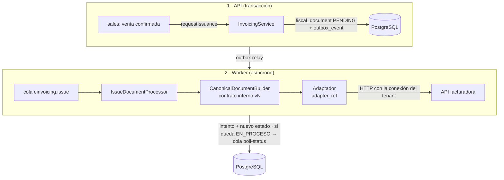
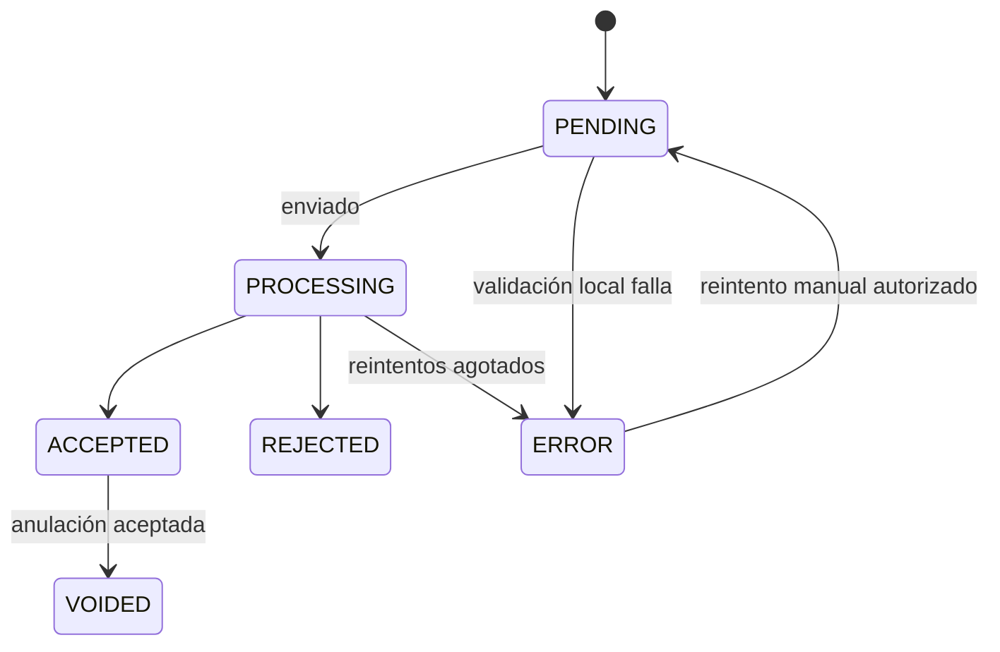

# Módulo de facturación electrónica (integración externa)

- **Decisión:** D2. YEBO **no** se comunica con SUNAT. Integra la API facturadora del cliente (o del propietario de YEBO) mediante configuración por tenant.
- **Estado:** diseño. **El adaptador definitivo queda bloqueado hasta documentar el contrato real de la API** (sección 6).

## 1. Principios

1. **Estados independientes.** La venta (`sales`) y el cobro (`payments`) se registran aunque la API facturadora esté caída. El comprobante (`fiscal_documents`) tiene su propio ciclo de vida.
2. **Asíncrono.** La emisión se encola (outbox → BullMQ). El POS muestra "PENDIENTE" o "EN PROCESO" y se actualiza al cambiar el estado.
3. **Idempotente.** Un comprobante por venta y tipo, con `idempotency_key` única, que se envía a la API si esta lo soporta.
4. **Sin datos ficticios.** PDF, XML y CDR provienen de la API facturadora. Si una empresa no tiene facturación electrónica, YEBO genera un **documento interno** (no fiscal), claramente rotulado como tal.
5. **Desacoplado.** Los módulos comerciales solo llaman a `InvoicingService.requestIssuance(saleId, documentType)`. No conocen la API.

## 2. Componentes



```ts
// Puerto (contrato interno). El adaptador real se implementa cuando exista el contrato documentado.
interface EInvoicingProvider {
  readonly adapterRef: string;            // p. ej. 'yebo-http@1'
  issue(doc: CanonicalFiscalDocument, cfg: ResolvedProviderConfig): Promise<IssueResult>;
  getStatus(ref: ExternalDocumentRef, cfg: ResolvedProviderConfig): Promise<StatusResult>;
  getFile(ref: ExternalDocumentRef, kind: 'PDF' | 'XML' | 'CDR', cfg: ResolvedProviderConfig): Promise<FileStream>;
  void?(ref: ExternalDocumentRef, reason: string, cfg: ResolvedProviderConfig): Promise<VoidResult>;
  testConnection(cfg: ResolvedProviderConfig): Promise<ConnectionTestResult>;
}
```

### 2.1 Tres capas con responsabilidades fijas

| Capa | Quién la controla | Qué contiene | Cómo cambia |
|---|---|---|---|
| **Contrato interno** (`CanonicalFiscalDocument` + puerto `EInvoicingProvider`) | Código de YEBO, `packages/contracts/einvoicing/v1` | Modelo canónico del comprobante (emisor, cliente, líneas, impuestos por línea, totales, moneda, referencias) y resultados normalizados (`IssueResult`, `StatusResult`, errores tipados) | Versionado semántico. Cambios aditivos = versión menor. Cambios incompatibles = `v2` en paralelo con `v1` |
| **Adaptador** (transformación) | Código de YEBO, `adapter_code@version` (p. ej. `yebo-http@1`) | Mapeo canónico ↔ formato de la API, interpretación de respuestas, clasificación de errores (reintentable o definitivo) | Solo por despliegue, con pruebas de contrato. Nunca desde la UI ni desde la base de datos |
| **Configuración de conexión** | Cada tenant (permiso `einvoicing.config.manage`) | URL base, rutas de endpoints, autenticación y credenciales (cifradas), cabeceras adicionales, timeout, reintentos, ambiente, series | Desde el panel, validada con "Probar conexión" y auditada |

**La transformación del formato no es configurable por el tenant.** Permitir plantillas de *payload* editables equivaldría a ejecutar lógica definida por el usuario: sería frágil, imposible de probar por adelantado y una fuente de comprobantes erróneos ante SUNAT. La configuración por tenant solo cambia **dónde** y **cómo autenticarse**, nunca **qué se envía**.

### 2.2 Versionado del contrato y de los adaptadores

- Cada `fiscal_document` guarda `contract_version` (p. ej. `1.2`) y `adapter_ref` (p. ej. `yebo-http@1`) con los que se emitió. Las consultas de estado, archivos y anulaciones posteriores usan **el mismo adaptador** con el que se emitió el comprobante.
- `einvoicing_configs.adapter_ref` fija la versión del adaptador del tenant. Una versión nueva se publica en paralelo y cada tenant se migra explícitamente (por YEBO o por el tenant), con "Probar conexión" antes de activarla.
- Registro de adaptadores en código: `AdapterRegistry.resolve('yebo-http@1')`. Una referencia desconocida es un error de configuración que se detecta al guardar, no al emitir.
- **Pruebas de contrato**: cada adaptador tiene una suite de *fixtures* (pares canónico → solicitud HTTP esperada, respuesta HTTP → resultado normalizado), generada a partir del contrato documentado de la API. Esa suite debe pasar para poder desplegar.
- El esquema canónico se valida con Zod **antes** de llamar al adaptador. Un comprobante inválido nunca sale de YEBO: pasa a `ERROR` con el detalle de la validación.

## 3. Ciclo de vida del comprobante

| Código interno | Etiqueta en UI | Significado |
|---|---|---|
| `PENDING` | PENDIENTE | Creado y aún no enviado |
| `PROCESSING` | EN_PROCESO | Enviado; la API aún no confirma el resultado final |
| `ACCEPTED` | ACEPTADO | Aceptado (con o sin observaciones; ver `acceptance_status`) |
| `REJECTED` | RECHAZADO | Rechazado por SUNAT u OSE. Estado final; requiere un nuevo comprobante |
| `ERROR` | ERROR | Fallo técnico agotados los reintentos, o error de validación. Reintentable manualmente |
| `VOIDED` | ANULADO | Anulado (comunicación de baja o nota de crédito, según soporte de la API) |



Los códigos se guardan en inglés por convención del código; las etiquetas en español se resuelven en la UI.

**Errores transitorios y definitivos.** Los timeouts, 5xx y 429 se reintentan con *backoff* exponencial (máximo configurable). Los 4xx de validación pasan directamente a `ERROR`, con el detalle visible para el usuario autorizado. Ante un timeout **tras** el envío, primero se consulta el estado (con la clave de idempotencia o la serie y correlativo) antes de reenviar. Así no se duplica un comprobante que la API pudo haber registrado.

## 4. Series y correlativos

- `fiscal_document_series`: tenant, sucursal (opcional), tipo de comprobante (catálogo SUNAT 01 factura, 03 boleta, 07 nota de crédito…), serie (`B001`, `F001`), tipos de operación que la usan (pasajes, encomiendas, carga) y canal de venta.
- **Punto por validar (S2):** quién asigna el correlativo.
  - **Modo `LOCAL`:** YEBO asigna el correlativo con bloqueo de fila (`UPDATE … SET next_number = next_number + 1 RETURNING`) en la misma transacción que crea el `fiscal_document`. Así no quedan saltos por fallos de envío.
  - **Modo `PROVIDER`:** la API devuelve el número. YEBO lo guarda al aceptarse.
  - El modelo soporta ambos con `numbering_mode` en la serie.

## 5. Datos del modelo

Ver el diccionario de datos: `einvoicing_configs`, `fiscal_document_series`, `fiscal_documents`, `fiscal_document_lines`, `fiscal_document_attempts` y `fiscal_document_files`.

- Las solicitudes y respuestas se guardan en `fiscal_document_attempts` **redactadas** (sin credenciales ni cabeceras de autenticación), con un límite de tamaño.
- Archivos: al pedirse, el worker los descarga de la API y los guarda en R2 con *checksum*; las siguientes descargas se sirven desde R2. Esto es una caché del documento oficial, no una regeneración, y se marca su origen.
- El listado de tickets y ventas muestra el tipo, la serie-número, el estado, la fecha de emisión, el estado de aceptación y las acciones PDF, XML y CDR, solo si la facturación está habilitada y el usuario tiene `einvoicing.documents.read`.

## 6. Contrato requerido de tu API (bloqueante para el adaptador)

Por favor, documenta o comparte (OpenAPI si existe):

1. **Autenticación:** tipo (API key en cabecera, Bearer, OAuth2 client credentials, HMAC), cabeceras exactas, expiración y renovación de tokens.
2. **Ambientes:** URL de pruebas y de producción; si las pruebas van contra la beta de SUNAT.
3. **Emisión:** endpoint, método, *payload* completo para boleta, factura y nota de crédito (cabecera, cliente, líneas, impuestos por línea, códigos de afectación de IGV, detracciones si aplica, moneda, formas de pago y cuotas).
4. **Numeración:** ¿la API asigna la serie y el correlativo o los recibe?
5. **Idempotencia:** ¿acepta una clave de idempotencia? ¿Qué devuelve si se reenvía la misma serie y número?
6. **Respuesta de emisión:** síncrona (CDR inmediato) o asíncrona (ticket o estado); identificador externo; estructura del estado SUNAT (código, descripción, observaciones).
7. **Consulta de estado:** endpoint y estados posibles.
8. **Archivos:** endpoints de PDF, XML y CDR; si devuelven binario, base64 o URL firmada; formatos de PDF (A4 o ticket 80 mm).
9. **Anulación:** comunicación de baja o resumen diario de boletas; nota de crédito; estados.
10. **Errores:** formato del error, códigos y cuáles son reintentables.
11. **Límites:** rate limits, tamaño máximo y timeouts recomendados.
12. **Multiempresa:** ¿una credencial por RUC emisor? ¿Cómo se identifica al emisor?
13. **Webhooks:** ¿notifica cambios de estado? Si es así, ¿cómo se firman?

Hasta recibirlo, la Fase 11 puede implementar el módulo completo **excepto** el adaptador. Las pruebas usarán un servidor de contrato local (no un *mock* en producción) basado en el contrato documentado.
