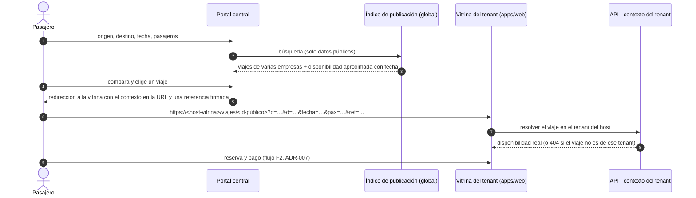
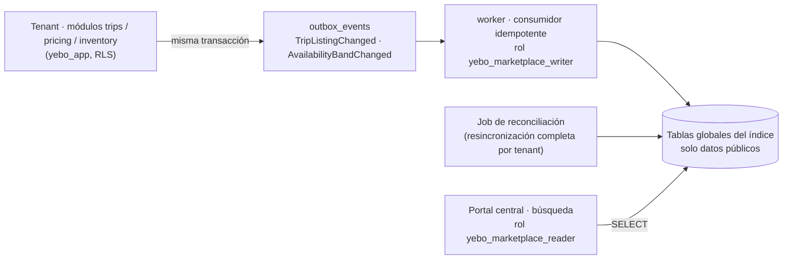

# Portal central de viajes e índice de publicación

- **Estado:** 📝 Propuesta (2026-11-09). **Nada implementado ni autorizado.** **El portal ocupa la raíz `yebo.pe/` y lo sirve `apps/site`** (AMP-D1, 2026-11-09; ADR-029 aceptado). La aceptación no autoriza la implementación. El índice (ADR-030) sigue **propuesto**, y quedan pendientes las decisiones AMP-Q2 a AMP-Q4 y AMP-Q15 (§7).
- **Origen:** ampliación funcional solicitada el 2026-11-09 ([changelog](../development/changelog.md)).
- **Ubicación en el roadmap:** preparación en las Fases 7 y 8; construcción en la Fase 13; despliegue en la Fase 15 ([roadmap §Ampliación funcional](../development/roadmap.md#ampliación-funcional-2026-11-09-propuesta)).
- **Documentos relacionados:** [multitenancy](../architecture/multitenancy.md) · [capacity-and-inventory](../architecture/capacity-and-inventory.md) · [MKT-01](../marketing/mkt-01-commercial-site.md) · [ingresos de la plataforma](platform-revenue.md) · [publicidad](advertising.md).

---

## 1. Tres experiencias públicas distintas

| Experiencia | Dirección | Público | Objetivo | Contexto de tenant | Dónde está planificada |
|---|---|---|---|---|---|
| **Portal central de viajes** (este documento) | `yebo.pe/` | Pasajeros | Descubrir y comparar viajes de todas las empresas publicadas | Ninguno: lee solo el índice público (§3) | Fase 13 · ADR-029, ADR-030 |
| **Sitio comercial** (MKT-01) | `yebo.pe/empresas` | Empresas de transporte | Captar clientes de YEBO | Ninguno | MKT-01 · ADR-027, ADR-029 |
| **Vitrina de cada tenant** | `<empresa>.yebo.pe` o dominio propio | Pasajeros y remitentes de esa empresa | Información comercial, reserva, compra y seguimiento | El del host (ADR-004) | Fases 5 y 13 · ADR-002 |

El portal central **no reemplaza** las vitrinas ni el sitio comercial. **No vende:** descubre y deriva. La consulta de disponibilidad real, la reserva y el pago siguen ocurriendo en la vitrina del tenant, en su dominio y bajo su contexto de tenant.

## 2. Recorrido del pasajero

- **El contexto viaja en la URL**, no en cookies: los dominios no comparten cookies (ADR-004). La URL lleva origen, destino, fecha, número de pasajeros y una referencia firmada del portal (`ref`), sin datos personales.
- **La vitrina valida el viaje contra su propio tenant.** Si el identificador público pertenece a otra empresa, responde `404`, igual que un recurso inexistente. El portal no puede hacer que una vitrina muestre datos de otro tenant.
- **La referencia firmada** (`ref`: identificador del anuncio del índice, fecha de emisión y firma) permite atribuir la venta al portal (comisión de la modalidad B, [platform-revenue §3](platform-revenue.md)). Las reglas de atribución son una decisión pendiente (AMP-Q8).
- **Terrestre y fluvial por igual.** El resultado muestra el tipo de unidad (bus, embarcación, lancha), la modalidad y las clases de espacio publicadas (asiento, cama, camarote, hamaca, zona libre…), con los mismos catálogos de `price_class_code` y de capacidades del modelo de inventario. No es un buscador de buses con los barcos añadidos después.
- **Sin cuenta global de pasajero.** El portal no crea un directorio de pasajeros (D4). Los datos del comprador solo existen en el tenant donde compra.

## 3. Índice de publicación (ADR-030, propuesto)

### 3.1 Problema

El buscador necesita leer viajes de **todos** los tenants. El aislamiento actual (ADR-003, ADR-025) impide eso con `yebo_app`, a propósito. Las alternativas que leen directamente las tablas de los tenants requieren `yebo_platform` (`BYPASSRLS`) detrás de un endpoint público, lo que rompe el modelo de privilegios de multitenancy §4.

### 3.2 Alternativas

| Opción | Descripción | Evaluación |
|---|---|---|
| A · Consulta directa | El buscador consulta `trips`, tarifas e inventario de todos los tenants con `yebo_platform` | **Descartada.** Un endpoint público con `BYPASSRLS`: un error de consulta expone datos de todos los tenants |
| B · Vista materializada entre tenants | Una vista sobre las tablas de tenant, refrescada periódicamente | **Descartada.** La sigue creando y leyendo un rol con acceso a todo, y no permite elegir qué se publica |
| **C · Proyección de lectura alimentada por eventos (recomendada)** | Tablas globales con **solo datos públicos**, escritas por un consumidor del outbox (ADR-008) con un rol dedicado | Aislamiento respaldado por PostgreSQL; el tenant decide qué publica; encaja con el outbox y los snapshots existentes |
| D · Motor de búsqueda externo | OpenSearch o Meilisearch alimentado por eventos | Posible **evolución** de C si el volumen lo exige. Al inicio añade infraestructura sin necesidad |

### 3.3 Diseño propuesto (opción C)

| Aspecto | Regla propuesta |
|---|---|
| **Qué se publica** | Solo lo que el tenant marca como publicable (por ruta o por viaje), si su plan incluye el módulo `MARKETPLACE` (AMP-Q2). Por defecto no se publica nada |
| **Contenido** | Datos públicos: empresa (nombre comercial, logo, host de la vitrina), modalidad y tipo de unidad, origen y destino por parada, salida y llegada estimadas, clases de espacio, tarifa "desde" por clase, características (equipaje, servicios a bordo), banda de disponibilidad y su fecha. **Nunca** pasajeros, clientes, ventas ni datos de personal |
| **Granularidad** | Un registro por viaje y por par de paradas vendible (origen → destino), igual que la venta por tramo (ADR-007). Una ruta con *N* paradas genera como máximo *N(N−1)/2* pares; el tenant puede limitar los pares publicados |
| **Propietario** | Cada registro guarda `tenant_id` como referencia de propiedad, **no como ámbito de RLS**: es una tabla global de plataforma, en la lista de multitenancy §4.3 con una excepción declarada, igual que `tenant_domains` |
| **Escritura** | Solo el consumidor del outbox, con un rol dedicado (`yebo_marketplace_writer`) que solo puede escribir en el índice y no lee tablas de tenant. El payload del evento ya contiene los datos públicos: el consumidor no consulta al tenant |
| **Lectura** | El endpoint de búsqueda usa un rol `yebo_marketplace_reader` con `SELECT` solo sobre el índice. `yebo_app` no tiene ningún permiso sobre él |
| **Altas y cambios** | Abrir la venta, cambiar horario o tarifa y cambiar la banda de disponibilidad emiten un evento en la **misma transacción** que el cambio de negocio |
| **Retiro** | Despublicar, cancelar el viaje, cerrar la venta, la salida del viaje y los estados del tenant que bloquean `NEW_COMMERCIAL` (ADR-023) retiran el registro. Además, cada registro **caduca** a la hora de salida aunque se pierda un evento |
| **Consistencia** | Eventual, con un objetivo de retraso a fijar (p. ej. < 60 s en el p95). Un job de reconciliación por tenant reconstruye su parte del índice de forma idempotente y corrige los eventos perdidos |
| **Disponibilidad mostrada** | **Bandas** (`DISPONIBLE`, `POCOS_ESPACIOS`, `AGOTADO`) con fecha de actualización, no cifras exactas (AMP-Q3). Así se emiten menos eventos bajo concurrencia y no se promete una plaza concreta |
| **Validación real** | El índice **nunca** es la fuente de verdad. Antes de reservar, la vitrina consulta el inventario del tenant, y la retención (`HOLD`) y la venta pasan por ADR-007. Si el índice estaba desactualizado, el pasajero ve la disponibilidad real en la vitrina |

### 3.4 Pruebas de aceptación (cuando se implemente)

- `yebo_app` no puede leer ni escribir el índice; `yebo_marketplace_reader` no puede leer ninguna tabla de tenant (prueba de privilegios, como multitenancy §7.7).
- Un viaje no publicado nunca aparece; uno de un tenant suspendido desaparece.
- Cambios de horario o tarifa visibles dentro del objetivo de retraso; un evento perdido lo corrige la reconciliación.
- El índice no contiene datos personales (verificación del esquema del payload).
- Un enlace con el viaje de otro tenant → `404` en la vitrina.
- Una carrera "el índice dice disponible, el tramo está agotado" termina en un rechazo controlado en la vitrina, nunca en una sobreventa.

## 4. Dominio, aplicación y SEO (ADR-029)

### 4.1 Distribución del dominio (aprobada, AMP-D1)

| Ruta | Experiencia |
|---|---|
| `yebo.pe/` | **Portal central:** búsqueda, resultados, páginas de rutas y destinos, y directorio de empresas transportistas |
| `yebo.pe/empresas` · `yebo.pe/empresas/...` | Sitio comercial de MKT-01 (B2B) |
| `<empresa>.yebo.pe` o dominio propio | Vitrina del tenant |

Este reparto **reemplaza** la asignación exclusiva de la raíz al sitio comercial que hacían ADR-027 y MKT-D5. Ninguno de los dos se edita: lo registran ADR-029 y AMP-D1.

**Estructura de URL propuesta para el portal.** Las rutas `/buscar`, `/rutas/...`, `/destinos/...` y `/transportistas/<slug>` son **propuestas sujetas a definición en la Fase 13**; no forman parte de AMP-D1:

| URL | Contenido | Indexable |
|---|---|---|
| `/` | Buscador y destinos destacados | Sí |
| `/buscar?origen=…&destino=…&fecha=…&pasajeros=…` | Resultados | **No** (`noindex`, canónica a la página de la ruta) |
| `/rutas/<origen>-<destino>` | Empresas, horarios habituales, modalidades y precios "desde" de la ruta | Sí |
| `/destinos/<ciudad>` | Cómo llegar, rutas que llegan y salen | Sí |
| `/transportistas/<slug>` | Ficha pública de la empresa con enlace a su vitrina | Sí |

**`/transportistas/` es el directorio público de empresas transportistas del portal.** No se confunde con:

- `/empresas`, que es el sitio comercial B2B de YEBO;
- las vitrinas (`<empresa>.yebo.pe`), que son el sitio propio de cada tenant. La ficha de `/transportistas/<slug>` es un resumen generado desde el índice y enlaza a la vitrina para todo lo demás.

### 4.2 SEO por intención de búsqueda

> Las rutas del portal que aparecen en esta sección y en §4.3 son las propuestas de §4.1, sujetas a definición en la Fase 13.

| Intención | Ejemplos de búsqueda (hipótesis por validar) | Destino |
|---|---|---|
| Viaje (B2C) | "pasajes Lima Huancayo", "lancha Iquitos Yurimaguas", "horarios de buses a Cusco" | Portal: `/rutas/…`, `/destinos/…` |
| Empresa de transporte por nombre | "Transportes X horarios" | La vitrina del tenant; el portal la enlaza desde `/transportistas/<slug>` |
| Software y soluciones (B2B) | "sistema de venta de pasajes", "software para transporte fluvial" | Sitio comercial: `/empresas/...` |

Reglas:

- **Títulos y `h1` separados por intención.** En el portal, la raíz y las páginas de rutas hablan de viajes. En `/empresas`, las páginas hablan de software. Así no compiten por las mismas consultas.
- **Sitemaps separados** (`/sitemap-viajes.xml` y `/empresas/sitemap.xml`) bajo un índice común. En Search Console, una propiedad de dominio más una propiedad de prefijo `https://yebo.pe/empresas/` para medir el B2B por separado.
- **Datos estructurados:**
  - en la raíz: `Organization` y `WebSite` con `SearchAction` (buscador del portal);
  - en las rutas: `BreadcrumbList`, y `ItemList` en las páginas con listados;
  - en `/empresas/funcionalidades`: `SoftwareApplication` (MKT-01 §4.3).
  - Sin valoraciones ni precios inventados.
- **Sin contenido duplicado con las vitrinas.** El portal resume y enlaza; la información completa del viaje es de la vitrina. Los resultados de búsqueda no se indexan.
- **Páginas de ruta solo con datos reales** del índice. No se generan rutas sin viajes publicados (se evita el *thin content*).
- **Analítica y conversiones separadas** por sección: búsqueda y derivación a la vitrina en el portal, `demo_submitted` en `/empresas`.

### 4.3 Aplicación (aceptada, AMP-D1)

`apps/site` (ADR-027) sirve las dos secciones con segmentos de ruta y layouts separados. **No existe `apps/marketplace` ni otra app para el portal:**

| Necesidad | Cómo se resuelve en `apps/site` |
|---|---|
| Sitio comercial estático y búsqueda dinámica | Renderizado por ruta: SSG/ISR en `/empresas`; SSR en `/buscar`; ISR en `/rutas`, `/destinos` y `/transportistas` |
| Navegación, layout y marca de cada público | Un layout por segmento; componentes compartidos solo desde `packages/ui` |
| Seguridad | Mismas condiciones de ADR-027: sin sesión, sin tenant, sin cookies de aplicación, sin acceso a la BD. CSP y caché por ruta |
| Rendimiento | Presupuesto por sección: el de MKT-01 (≤ 70 KB de JS) se mantiene en `/empresas`; el portal tiene el suyo |
| Publicidad (PUB-01) | Solo en las rutas del portal; nunca en `/empresas` |

**Coste aceptado:** el despliegue es común a las dos secciones. Se reevaluaría la separación solo ante una métrica concreta (tráfico, frecuencia de despliegue o incidentes que crucen de una sección a otra).

## 5. Dependencias

| Depende de | Por qué | Tipo |
|---|---|---|
| Fase 3 | Rate limit del endpoint público; matriz de privilegios con roles dedicados | Bloqueante |
| Fase 4 | Módulo `MARKETPLACE` en los planes | Bloqueante |
| Fase 5 | Vitrinas por host a las que se deriva | Bloqueante |
| Fase 7 | Viajes, paradas y tarifas: **los eventos de publicación se definen aquí**, para no tener que reconstruirlos | Bloqueante (preparación) |
| Fase 8 | Inventario y retención: bandas de disponibilidad y venta; atribución `ref` en la venta | Bloqueante |
| Fase 13 | Reserva pública en la vitrina y enlace directo al viaje | Construcción |
| Fase 15 | Despliegue de `apps/site` con las dos secciones, CDN, monitorización del retraso del índice | Publicación |
| MKT-01.2 | `apps/site` existe primero con la sección `/empresas`; el portal se añade como otra sección | Coordinación |
| D9 (pasarela de pago, pendiente) | Pago en línea en la vitrina; también el flujo del dinero (AMP-Q13) | Bloqueante para vender en línea |
| Asesoría legal | Responsabilidad del portal como intermediario, términos y Libro de Reclamaciones (AMP-Q15) | Bloqueante para publicar |

## 6. Fuera del alcance

- Venta o pago dentro del portal central (se deriva siempre a la vitrina).
- Cuenta global de pasajero y viajes combinados entre empresas.
- Encomiendas y carga en el portal central (solo pasajeros; se puede reevaluar).

## 7. Decisiones pendientes

| ID | Pregunta | Recomendación (no decidida) |
|---|---|---|
| ~~AMP-Q1~~ | ~~Dominio y app del portal central frente a ADR-027~~ | **Resuelta** (AMP-D1): portal en la raíz y sitio comercial en `/empresas`, ambos servidos por `apps/site` (§4.1 y §4.3) |
| AMP-Q2 | ¿Publicar es opcional por tenant? ¿Está incluido en el plan o tiene cargo? | Módulo `MARKETPLACE` por plan, *opt-in* por ruta o viaje |
| AMP-Q3 | Disponibilidad mostrada: bandas o cifras exactas | Bandas con fecha de actualización |
| AMP-Q4 | Orden de los resultados y convivencia con los resultados patrocinados | Orden neutral (hora de salida o precio, a elección del pasajero); los patrocinados rotulados y separados ([advertising §4](advertising.md)) |
| AMP-Q15 | Responsabilidad del portal como intermediario: protección al consumidor, términos de uso y Libro de Reclamaciones | Validar con un asesor legal antes de publicar |
