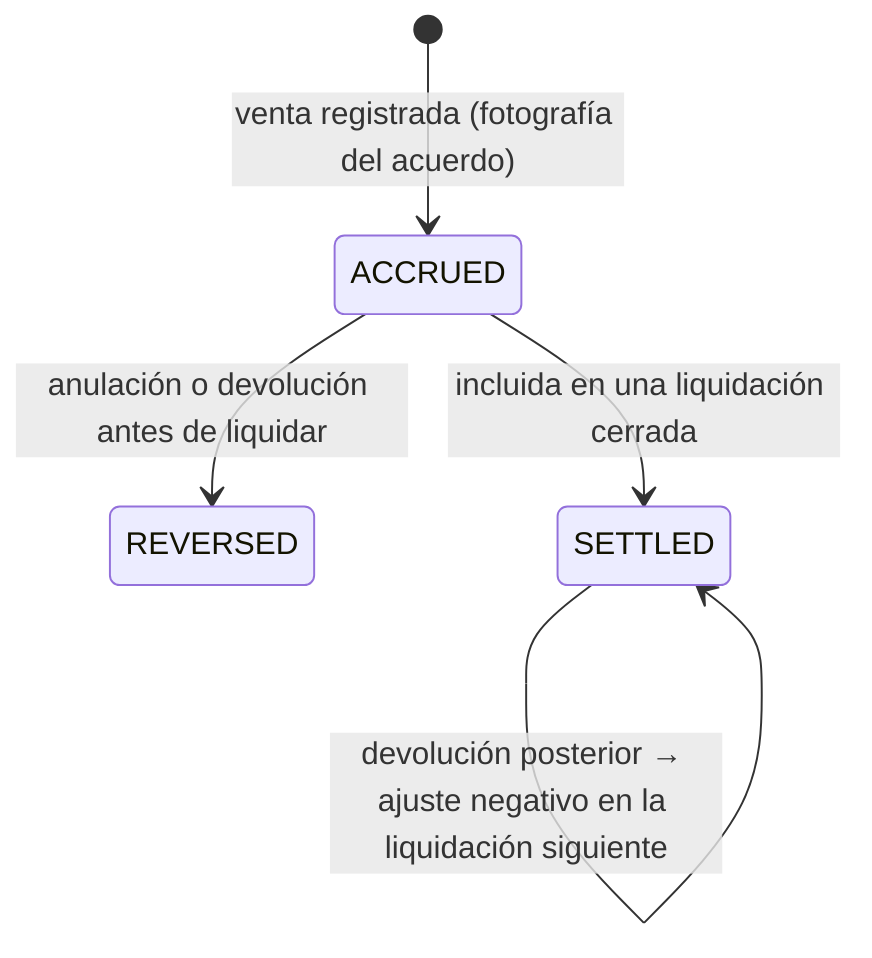

# Ingresos de la plataforma: acuerdos comerciales, suscripción por usuario y comisiones

- **Estado:** 📝 Propuesta (2026-11-09). **Nada implementado ni autorizado.** Decisiones de arquitectura: ADR-031 y ADR-032 (**Propuestos**). Decisiones de negocio pendientes: AMP-Q8 a AMP-Q14 y AMP-Q16 (§6).
- **No se fija ningún precio ni ninguna tasa definitiva.** El 1 % de comisión es solo una referencia negociable; los importes que aparecen son ejemplos.
- **Ubicación en el roadmap:** Fase 4 (acuerdos y suscripción), Fase 8 (fotografía del acuerdo en cada venta) y Fase 11 (devengo, liquidación y conciliación de comisiones).
- **Documentos relacionados:** [billing.md](billing.md) (medición D5, ADR-016) · [multitenancy §5](../architecture/multitenancy.md) (estados del tenant) · [portal central](marketplace.md) · [publicidad](advertising.md).

---

## 1. Qué ya existía y qué cambia

| Concepto | Ya contemplado (Fase 1, sin implementar) | Qué añade esta ampliación |
|---|---|---|
| Usuario facturable | D5 y ADR-016: pico diario de cuentas humanas habilitadas simultáneamente; no cuentan sesiones, dispositivos ni conexiones | **Nada.** La definición se respeta tal cual |
| Importe de la suscripción | `plan_versions`: `base_price + extra_users × extra_user_price`; `subscriptions.price_override jsonb` para acuerdos especiales | **Precio por usuario negociado por tenant**, con historial estructurado y versionado (§2), en lugar de un JSON libre |
| Factura de YEBO a la empresa | `platform_invoices` con líneas `BASE`, `EXTRA_USERS`, `ADDON`, `ADJUSTMENT` y `CREDIT`; `subscription_payments` de registro manual | Un tipo de línea para la comisión y, si se decide, para la publicidad (§4) |
| Comisiones | `commission_accruals` y `settlements`: **la empresa paga a sus agencias** (D7, módulo `AGENCIES`, apagado) | **Comisión de plataforma: la empresa paga a YEBO.** Es otro concepto y otro sentido del dinero, así que **no reutiliza** esas tablas (§3) |
| Canal de venta | ADR-020: toda venta registra el canal, la agencia y el vendedor desde el día 1 | La atribución al portal central (`ref`, [marketplace §2](marketplace.md)) para la modalidad B |
| Morosidad | D8 y ADR-023: `PAST_DUE` → `SUSPENDED` a los 7 días; nunca se bloquea el cumplimiento | Las comisiones impagas siguen la misma política (AMP-Q12) |

## 2. Acuerdos comerciales por tenant (ADR-031, propuesto)

### 2.1 Alternativas

| Opción | Evaluación |
|---|---|
| A · Un plan por empresa | Ensucia el catálogo de planes; pierde la diferencia entre la oferta pública y la negociación |
| B · `subscriptions.price_override jsonb` (existente) | Ya aprobado, pero no tiene vigencias, historial consultable ni sitio para la comisión |
| **C · Acuerdos comerciales versionados por tenant (recomendada)** | El plan define módulos y límites; el acuerdo define el precio negociado y la comisión, con vigencia e historial inmutable (ADR-010) |

### 2.2 Modelo propuesto (no es esquema: se diseña en la Fase 4)

- **`commercial_agreements`** (global, ámbito plataforma, gestionada con `yebo_platform`): una por tenant.
- **`commercial_agreement_versions`**: inmutables al aprobarse. Cada versión tiene:
  - `valid_from`, `valid_to?`, moneda, motivo, quién la aprobó y la referencia al contrato;
  - **componente de suscripción:** precio por usuario facturable, `base_price` (puede ser 0), usuarios incluidos (puede ser 0), mínimo facturable (opcional) e intervalo;
  - **componente de comisión:** porcentaje, modalidad (`ALL_TICKETS` o `YEBO_CHANNELS`), base de cálculo (AMP-Q10), conceptos incluidos (por defecto solo `PASSENGER_FARE`).
- **Vigencia:** un cambio crea una versión nueva **desde una fecha futura o desde el período siguiente**. Nunca se reescribe una versión aprobada ni se recalcula lo ya devengado.
- **Precedencia:** si existe una versión vigente, prevalece sobre los precios del `plan_version`; si no, se aplican los del plan. Los módulos y límites siguen saliendo siempre del plan.
- **Auditoría:** toda creación, aprobación y cierre de versión queda en `audit_logs` con el usuario de plataforma.

### 2.3 Suscripción por usuario habilitado

La fórmula de billing §5 no cambia; solo cambia **de dónde salen los precios**:

```
usuarios_facturables = valor del período según ADR-016 (por defecto PEAK_DAILY de peak_concurrent)
adicionales          = MAX(0, usuarios_facturables − incluidos_del_acuerdo)
importe              = base_del_acuerdo + adicionales × precio_por_usuario_del_acuerdo
```

Ejemplo **ilustrativo** (no es un precio): base 0, 0 incluidos, S/ X por usuario y un pico de 8 en el período → 8 × X.

- `usage_period_calculations` guarda la **copia de la versión del acuerdo** usada, igual que hoy guarda la del plan.
- El historial de usuarios considerados ya existe por diseño (snapshots diarios con las membresías contadas, billing §4). Las altas y bajas salen de `membership_status_history`.
- Prorrateo y cambios a mitad de período: se mantiene la regla vigente (billing §7: desde el período siguiente; prorrateo por validar).

## 3. Comisión por venta de pasajes (ADR-032, propuesto)

### 3.1 Modalidades

| Modalidad | Ventas comisionables | Dependencia |
|---|---|---|
| **A · `ALL_TICKETS`** | Todos los pasajes registrados en YEBO: ventanilla, vendedores, agencias, vitrina y portal central | Solo ve lo que se registra en YEBO; ventas fuera del sistema → AMP-Q9 |
| **B · `YEBO_CHANNELS`** | Solo las ventas por los canales digitales de YEBO | Qué cuenta como canal de YEBO y la regla de atribución → AMP-Q8 |

### 3.2 Fotografía del acuerdo en cada venta

Exigencia: cada venta conserva el acuerdo aplicable **en el momento de su registro**, y un cambio posterior no recalcula nada.

- En la **misma transacción** que la venta (núcleo comercial, ADR-014), cada `sale_line` de un concepto comisionable genera un registro **`platform_fee_accruals`** (tabla de tenant, con RLS; el nombre evita la confusión con `commission_accruals` de las agencias) con:
  - `agreement_version_snapshot snap`: porcentaje, modalidad, base y versión;
  - `commissionable bool` y su motivo (p. ej. "modalidad B, canal ventanilla → no comisionable");
  - `base_amount`, `fee_amount`, moneda, canal y atribución (`ref`);
  - estado `ACCRUED | REVERSED | SETTLED`.
- **Se registra también cuando no es comisionable** (importe 0, con motivo). Así la conciliación y la vista del tenant explican cada venta.
- La tabla es de tenant: el tenant la consulta (transparencia) y solo la escribe el código del núcleo comercial, nunca un endpoint de edición.

### 3.3 Ciclo de vida



- **Anulaciones y devoluciones** (`SaleCancelled`, `RefundPaid`, ADR-014): antes de liquidar, `REVERSED`; después, un **ajuste** negativo en el período siguiente, con motivo. Nunca se modifica una liquidación cerrada (igual que billing §6). El tratamiento de devoluciones parciales, cambios y reprogramaciones es AMP-Q11.
- **Liquidación:** un job de plataforma agrega por período los devengos de cada tenant en `platform_fee_settlements` (global) y genera la línea correspondiente de `platform_invoices` (AMP-Q12: factura conjunta o separada). Período cerrado = inmutable.
- **Conciliación:** suma de devengos = líneas liquidadas + ajustes; diferencias → alerta, nunca un ajuste silencioso.
- **Estado del tenant:** las ventas de posventa permitidas en suspensión (ADR-023) siguen generando reversiones. La morosidad de comisiones sigue D8 (AMP-Q12).

## 4. Gestión comercial y financiera

| Capacidad | Superadmin (`apps/platform`) | Tenant (panel, categoría `BILLING_SELF`) | Fase |
|---|---|---|---|
| Empresas registradas, estado y plan | Consultar y gestionar | — | 4 |
| Acuerdos comerciales e historial | Crear versiones, aprobar, cerrar; auditoría | Consultar el acuerdo vigente y el historial | 4 |
| Usuarios facturables | Por período y por día, con detalle | La misma vista, de su empresa | 4 |
| Suscripción, facturas, pagos, vencimientos y saldos | Registrar pagos (manual en el MVP), ver saldos y vencimientos | Ver facturas, pagos y saldo | 4 |
| Comisiones devengadas | Por tenant, período, canal y modalidad | Detalle por venta, con la fotografía del acuerdo | 11 |
| Liquidaciones y conciliación | Generar, revisar, cerrar, ajustar | Consultar liquidaciones y ajustes | 11 |
| Anunciantes y campañas | Ver [advertising.md](advertising.md) | — | PUB-01 |
| Auditoría comercial | Toda modificación de acuerdos, precios, pagos y ajustes | — | 4 y 11 |

El panel del tenant separa siempre tres conceptos: **1)** comisión por venta de pasajes, **2)** suscripción por usuarios habilitados y **3)** otros cargos (`ADDON`, publicidad si aplica, ajustes). Para cada uno muestra el período, la base, el cálculo, los pagos y el saldo.

Permisos de plataforma: se separan, al menos, **comercial** (acuerdos), **finanzas** (pagos, liquidaciones y ajustes) y **solo lectura**, dentro de `platform_users`, como se aprobó para los prospectos (ADR-028, condición 4). El diseño detallado se hace en la Fase 4.

## 5. Implicaciones

- **Modelo de ventas (Fase 8):** la fotografía del acuerdo y la atribución deben existir **desde la primera venta**. Añadirlas después no permite reconstruir el acuerdo aplicable a las ventas ya hechas.
- **Canales:** ADR-020 ya registra el canal. Para la modalidad B falta distinguir "online en la vitrina" de "online derivada del portal central" (`ref`).
- **Facturación electrónica:** las facturas de YEBO por comisión (y por publicidad) se emiten por el mismo puerto (ADR-015) con la configuración de la plataforma; el tratamiento tributario está por validar con un contador (S5, AMP-Q16).
- **Flujo del dinero en ventas en línea:** si el pasajero paga con la pasarela **del tenant**, YEBO solo factura la comisión. Si YEBO cobrara y luego liquidara al tenant, YEBO custodiaría fondos de terceros, con implicaciones regulatorias y contables. Decisión AMP-Q13.

## 6. Decisiones pendientes

| ID | Pregunta | Recomendación (no decidida) |
|---|---|---|
| AMP-Q8 | Modalidad B: ¿qué es "venta mediante YEBO"? ¿Solo las derivadas del portal central o también la venta en línea en la vitrina? ¿Con qué ventana de atribución? | Definir los canales explícitamente en el acuerdo; atribución por `ref` con ventana acotada (p. ej. la misma reserva) |
| AMP-Q9 | Modalidad A: ¿cómo se tratan las ventas que la empresa no registra en YEBO? ¿Obligación contractual de registrar todo? ¿Derecho de auditoría o cruce con comprobantes? | Cláusula contractual + conciliación con los comprobantes emitidos por YEBO |
| AMP-Q10 | Base de cálculo: ¿con o sin IGV? ¿Incluye exceso de equipaje, cargos y descuentos? Redondeo | Importe neto de impuestos, solo `PASSENGER_FARE`, redondeo por línea (validar con contador) |
| AMP-Q11 | Devoluciones parciales, cambios, reprogramaciones y no-shows | Reversión proporcional al importe devuelto; los cambios sin devolución no alteran el devengo |
| AMP-Q12 | Periodicidad de liquidación; factura conjunta con la suscripción o separada; vencimiento y morosidad | Mismo período y misma factura, con líneas separadas; la misma política D8 |
| AMP-Q13 | ¿Quién cobra al pasajero en las ventas en línea: la pasarela del tenant o YEBO? | Pasarela del tenant (YEBO no custodia fondos); se decide con D9 |
| AMP-Q14 | Suscripción: ¿mínimo facturable, base fija o usuarios incluidos? ¿Se confirma `PEAK_DAILY` como métrica del período? | Configurable por acuerdo; mantener `PEAK_DAILY` (D5) |
| AMP-Q16 | Tratamiento tributario de la comisión y de la publicidad facturadas por YEBO | Validar con un contador (S5) |
